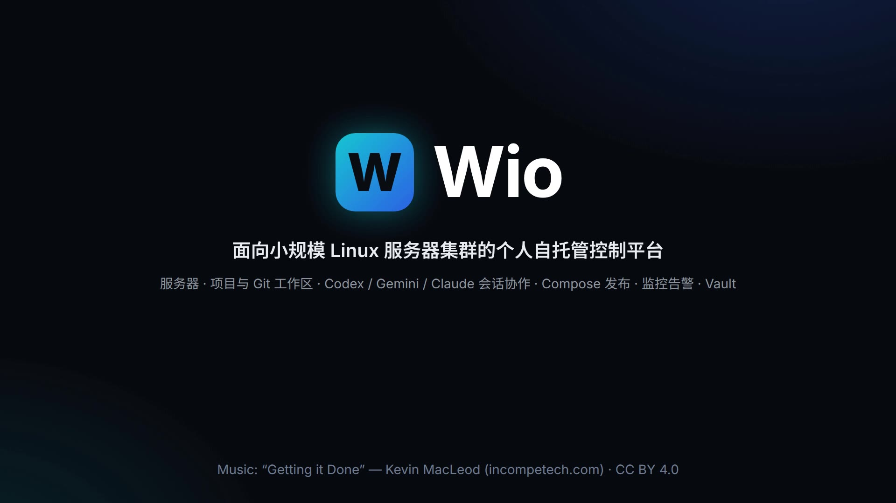
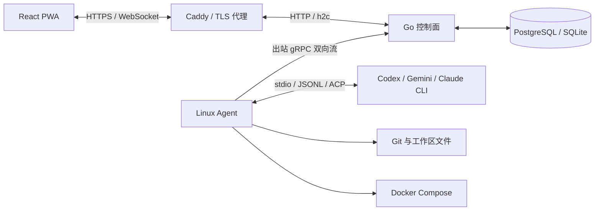

# Wio

Wio 是面向小规模 Linux 服务器集群的个人自托管控制平台。通过一个响应式 Web / PWA 界面，管理服务器、Git 项目与工作区、Codex / Gemini / Claude 会话、Docker Compose 部署、监控、告警和加密凭据。

面向单管理员、1–20 台 Linux 服务器、约 200 个项目的使用场景。控制面可在 Linux、macOS、Windows 上开发运行；Agent 与部署执行端仅支持 Linux。Wio 不提供通用终端或完整 Web IDE，不面向多租户或 Kubernetes。

## 产品演示

[](https://eversleeping.github.io/My-Wio/video.html)

点击封面[在线播放演示视频](https://eversleeping.github.io/My-Wio/video.html)（2 分 9 秒，1080p / 60 FPS），了解服务器管理、项目与 Git 工作区、三种 AI 引擎、多 Agent 协作、运维与移动端界面。画面来自真实产品，协作运行过程经过延时剪辑。也可[下载 MP4](docs/assets/wio-product-film.mp4?raw=true) 离线观看。

音乐：“Getting it Done” — Kevin MacLeod（[incompetech.com](https://incompetech.com/)），采用 [CC BY 4.0](https://creativecommons.org/licenses/by/4.0/) 授权；已剪辑、调整音量并做结尾淡出。

## 文档入口

| 文档 | 内容 |
| --- | --- |
| [用户手册](docs/USER_GUIDE.md) | 首次配置、日常操作、三种 AI 会话、协作、定时任务、部署和故障处理 |
| [生产部署](docs/PRODUCTION_DEPLOYMENT.md) | PostgreSQL、TLS、独立 / 宿主机 Caddy、目录挂载、升级与验收 |
| [运维参考](docs/OPERATIONS.md) | 操作中断、连接与扫描排查、数据保留策略 |
| [Claude 接入](docs/CLAUDE.md) / [Gemini 接入](docs/GEMINI.md) | CLI 认证、兼容版本和运行限制 |
| [会话协作协议](docs/SESSION_COLLABORATION.md) | 工具、授权范围、请求去重和执行生命周期 |
| [前端 E2E](web/e2e/README.md) | 隔离浏览器测试的运行方式与覆盖边界 |

本文与用户手册按当前仓库实现维护；当前 Wio 版本见 [internal/buildinfo/version.go](internal/buildinfo/version.go)。功能是否开放还取决于目标 Agent 和实际 CLI 的版本，不能仅根据控制面版本判断。

## 主要能力

- **服务器管理**：SSH 指纹确认、一次性令牌注册、依赖安装、修复注册、Agent 自更新、三种 AI CLI 版本管理、凭据独立下发及服务器下线。
- **项目与 Git**：空白项目、远程克隆、已有仓库发现；Gitee / GitHub / GitLab 远程创建；项目筛选、置顶、隐藏和归档；分支、远程、提交、同步、worktree、工作区移动/复制及删除预检。
- **工作区文件**：文件树、文本和常见图片预览、diff、新建/上传和文本编辑；写入前校验文件版本，避免覆盖他人的改动。
- **AI 会话**：Codex app-server、官方 Gemini CLI 和 Claude Code CLI；流式消息、工具结果、图片、续聊、运行中追加指令、提问、消息编辑重发、分支和归档。审批、目标模式、技能管理等能力因引擎而异，见[能力对照](docs/USER_GUIDE.md#7-ai-会话通用操作)。
- **会话协作与定时任务**：在用户授权范围内创建/分叉正式 Wio 会话，选择共享目录或独立 worktree，查询结果及可选自动续聊；三种引擎均支持复用已有会话定时执行。
- **Compose 发布**：已有工作区或远程仓库来源、部署预检、受支持项目模板、Vault 环境变量、健康检查、日志、不可变配置/镜像快照和历史回滚。
- **运维与安全**：操作中心及扫描中断，CPU/内存/磁盘/负载/网络监控，告警与审计；密码、TOTP 或组合登录，CSRF、防暴力登录和 AES-256-GCM Vault；中英文界面及可安装的 PWA。

## 架构与执行边界



控制面在同一端口提供 HTTP、WebSocket 和 gRPC。生产环境由代理终止 TLS，gRPC 上游须支持 h2c；Agent 主动连接控制面，链路使用 TLS 和 Bearer Agent Token 鉴权。SSH 仅用于注册、修复和彻底下线，不作为日常操作通道。

Wio 向 Agent 下发结构化操作；AI CLI 和 Compose 项目仍会按执行账号权限运行代码。共享工作区共享文件：Codex 的不同会话可以并行，Claude / Gemini 与 Git 等写操作使用工作区写锁。需要隔离修改时使用独立 worktree；它隔离 Git 工作目录，不提供系统权限隔离。

## 环境要求

| 场景 | 要求 |
| --- | --- |
| 本地开发 | Go 1.22+、Node.js 22+、npm；先构建前端再编译控制面 |
| 生产控制面 | Linux、Docker Engine、Compose v2、公共域名和 HTTPS 入口；默认 Caddy 使用 80/443 |
| 外部 Agent | Linux amd64/arm64、systemd、SSH；注册账号为 root 或可免交互 sudo 的用户 |
| 外部连接 | Agent 可访问控制面；按需访问 Git、模型服务及 npm/浏览器下载源 |

SSH 注册/修复会尝试补装 Git、Docker/Compose、Node.js/npm、三种 AI CLI 和 Playwright/Chromium，支持 apt-get、dnf、yum。核心 Agent 安装失败会终止流程；可选依赖失败会保留能力警告。CLI 已安装不代表模型认证成功。

## 本地快速开始

在仓库根目录运行：

```bash
go mod download
npm --prefix web ci
npm --prefix web run build
go run ./cmd/controlplane
```

打开 [http://127.0.0.1:8080](http://127.0.0.1:8080)，也可先检查服务：

```bash
curl --fail --silent http://127.0.0.1:8080/api/health
```

首次创建管理员需要一次性设置令牌。未指定 `WIO_SETUP_TOKEN` 时，从启动终端的 `FIRST-RUN SETUP TOKEN` 日志中读取 `setup_token`；管理员创建后令牌失效。可选择固定密码、TOTP/恢复码或两者组合，固定密码至少 12 个字符；立即离线保存恢复码。

未设置数据库和主密钥时，使用仓库根目录的 `wio.db` 和固定开发 Vault 密钥。这个默认环境只用于本地试用，不应保存真实凭据；真实环境必须显式配置 `WIO_MASTER_KEY`。本地运行默认监听 `:8080`，需要仅允许回环访问时设置 `WIO_ADDR=127.0.0.1:8080`。

首次使用顺序：

1. 在 **设置** 创建 Codex API 预设；需要私有仓库和提交时创建带姓名、邮箱的 Git 预设。
2. 在 **服务器** 注册 Linux 主机并核对 SSH 指纹；或使用已具备运行环境的内置控制机 Agent。
3. 等待服务器在线，检查所需 CLI、Git、Docker 与凭据状态。
4. 在 **项目** 创建、克隆或发现仓库，再在 **Codex / Gemini / Claude** 选择工作区创建会话。Gemini / Claude 认证可在注册后单独配置。
5. 需要发布时创建 Vault 密钥集和部署目标。完整步骤见[用户手册](docs/USER_GUIDE.md)。

## 生产部署

完整步骤及宿主机已有反向代理时的方案见[生产部署指南](docs/PRODUCTION_DEPLOYMENT.md)。以下命令适用于专用主机和独立 Caddy：

```bash
umask 077
cp .env.example .env
openssl rand -base64 32  # 将输出写入 .env 的 WIO_MASTER_KEY
openssl rand -base64 36  # 将输出写入 .env 的 POSTGRES_PASSWORD
```

编辑 `.env`，设置 `WIO_DOMAIN`、数据库密码、`WIO_DATABASE_URL` 和 Vault 主密钥。数据库 URL 的密码必须与 `POSTGRES_PASSWORD` 对应，并对 URL 保留字符编码。然后运行：

```bash
docker compose --env-file .env -f deploy/docker-compose.yml up -d --build
docker compose --env-file .env -f deploy/docker-compose.yml ps
docker compose --env-file .env -f deploy/docker-compose.yml logs --tail=100 controlplane
```

打开 `https://<WIO_DOMAIN>`，使用日志中的设置令牌初始化管理员。数据库、Caddy 证书和内置 Agent 状态保存在命名卷中。

**确认挂载范围后再启动**：默认 Compose 挂载宿主机 `/srv`、`/opt`、`/home` 和 Docker socket。镜像已包含 Git、Docker CLI/Compose、Node.js/npm、Codex、Gemini、Claude CLI，内置 Agent 可操作这些挂载；它看到的指标和目录受容器环境影响。Docker socket 具有宿主机高权限。需要专用工作区隔离或宿主机代理时，使用部署指南中的 `docker-compose.host-proxy.yml`；仅填写 `WIO_WORKSPACE_ROOT` 不会改变默认方案的挂载。

镜像中的 CLI 基线固定在 [Dockerfile](deploy/controlplane.Dockerfile)，与 SSH 注册时获取最新正式版的流程不同。例如当前镜像的 Gemini CLI 基线为 `0.65.0`，使用需要 `0.66.0+` 的目标模式或技能管理前，须通过 **设置 → Gemini CLI 版本管理** 与 **服务器 → 管理 AI Agent** 更新。

Linux 控制面默认运行内置“控制机”Agent，该服务器记录不能撤销。设置 `WIO_CONTROL_AGENT_ENABLED=false` 可停用它，记录保留为离线。直接从源码运行控制面时，所需工具、目录权限和凭据须由运行环境提供。

## 运行配置

控制面直接读取以下环境变量。Compose 只传入其 `environment` 中声明的变量；新增配置时需在 Compose 覆盖文件中显式传入，单独写入 `.env` 并不会自动注入容器。

| 变量 | 默认值 | 用途 |
| --- | --- | --- |
| `WIO_ADDR` | `:8080` | HTTP / WebSocket / gRPC 监听地址 |
| `WIO_DATABASE_URL` | `wio.db?_pragma=foreign_keys(1)&_pragma=busy_timeout(5000)` | SQLite DSN 或 PostgreSQL URL；生产使用 PostgreSQL |
| `WIO_MASTER_KEY` | SQLite 未设置时使用开发密钥 | Base64 编码的 32 字节 Vault 主密钥；生产必须固定保存 |
| `WIO_PUBLIC_URL` | 空 | 用户与外部 Agent 可访问的基址；生产使用 HTTPS，Compose 根据 `WIO_DOMAIN` 设置 |
| `WIO_SETUP_TOKEN` | 首次初始化时自动生成 | 创建首个管理员的一次性令牌；未初始化前每次重启会重新生成 |
| `WIO_DEV_INSECURE` | `false` | 仅开发使用，允许 HTTPS 基址下关闭 Secure Cookie |
| `WIO_TRUSTED_PROXIES` | 空；Compose 为回环和私有网段 | 可信反向代理 IP/CIDR，逗号分隔；仅信任这些连接方的 `X-Forwarded-For` |
| `WIO_AGENT_ASSET_DIR` | `/usr/local/share/wio` | 网页 SSH 安装使用的 Agent 和 systemd 资产目录 |
| `WIO_CONTROL_AGENT_ENABLED` | Linux 上 `true` | 是否运行内置控制机 Agent |
| `WIO_POSTGRES_MAX_OPEN_CONNS` | `20` | PostgreSQL 最大连接数，必须为正整数 |
| `WIO_AUDIT_RETENTION_DAYS` | `0` | 审计日志保留天数；0 或未设置表示永久保留 |
| `WIO_OPERATION_RETENTION_DAYS` | `0` | 可清理的已结束操作保留天数；会话、协作、部署等依赖记录受保护 |

内置 Agent 的覆盖配置：

| 变量 | 默认值 |
| --- | --- |
| `WIO_CONTROL_AGENT_URL` | 当前监听端口的 `http://127.0.0.1:<port>` |
| `WIO_CONTROL_AGENT_SCAN_ROOTS` | `/srv,/opt,/home`；Compose 额外包含 `/var/lib/wio-agent/projects` |
| `WIO_CONTROL_AGENT_CLONE_ROOT` | `/var/lib/wio-agent/projects` |
| `WIO_CONTROL_AGENT_STATE_DIR` | `/var/lib/wio-agent` |
| `WIO_CONTROL_AGENT_CODEX_PATH` | `codex` |
| `WIO_CONTROL_AGENT_CODEX_KEY_FILE` | `/var/lib/wio-agent/codex.key` |
| `WIO_CONTROL_AGENT_DOCKER_PATH` | `docker` |
| `WIO_CONTROL_AGENT_PREREQUISITE_SOCKET` | `/run/wio-prerequisites/helper.sock` |
| `WIO_CONTROL_AGENT_INSECURE_SKIP_VERIFY` | `false`，仅可用于临时开发 |

外部 Agent 配置位于 `/etc/wio-agent/config.json`；网页注册负责生成配置和 systemd 服务。默认状态目录为 `/var/lib/wio-agent`，克隆目录为其中的 `projects`，发布目录为其中的 `releases`。

## 开发与验证

先完成快速开始的依赖安装和前端构建，再分别在两个终端运行：

```bash
# 终端 1
go run ./cmd/controlplane

# 终端 2
npm --prefix web run dev
```

访问 [http://127.0.0.1:5173](http://127.0.0.1:5173)。Vite 将 `/api` 和 WebSocket 代理至 `127.0.0.1:8080`；调整控制面端口时须同步修改开发代理。

| 命令 | 用途 |
| --- | --- |
| `make build` | 构建前端，生成当前平台的 `bin/wio-controlplane` 和 `bin/wio-agent` |
| `make agent-linux` | 额外构建 Linux amd64 Agent |
| `make test` | PostgreSQL 迁移/存储集成测试、前端构建、Go 测试、Vitest 和类型检查 |
| `go vet ./...` | Go 静态检查，须已有 `web/dist` |
| `npm --prefix web run e2e` | Playwright 桌面/移动端隔离测试 |

控制面通过 `go:embed` 嵌入 `web/dist`，干净检出必须先构建前端。PostgreSQL 集成测试会下载并启动临时 PostgreSQL 16，需要可用下载源且应以非 root 账号运行；不连接生产数据库。E2E 首次需在 `web` 目录执行 `npx playwright install chromium`，测试使用模拟 API，不验证真实服务器或付费模型调用。

## 备份与安全

应一起加密备份：

- 控制面数据库、`.env` 和原始 `WIO_MASTER_KEY`；丢失主密钥无法恢复 Vault 中的凭据和 TOTP 等数据。
- 内置 Agent 的 `controlplane_agent_state` 卷，及需要保留的外部 Agent `/etc/wio-agent`、`/var/lib/wio-agent`。
- AI CLI 原生会话目录：默认位于 Agent 账号的 `~/.codex`、`~/.gemini`、`~/.claude`，使用自定义目录时备份实际路径。仅备份控制面数据库不足以恢复原生续聊。
- 重要工作区、发布数据和应用数据卷，以及 Caddy 的 `caddy_data`、`caddy_config`。

```bash
docker compose --env-file .env -f deploy/docker-compose.yml exec -T postgres \
  pg_dump -U wio -Fc wio > wio.dump
```

SQLite 应停机备份或使用在线备份工具，避免只复制正在写入的主文件。恢复时使用与数据库配套的主密钥，并核对实际 Agent 路径与权限。

Wio 面向可信单管理员环境。SSH 凭据仅用于当前请求；API Key、Git Token 和部署密钥在控制面加密保存，不回显明文。外部 Agent 默认使用专用账号和 systemd 文件系统限制；显式启用免密 sudo 会放宽限制并授予 `NOPASSWD: ALL`。Docker 权限同样接近 root。模型权限设置仍受系统权限约束，删除和中断不会自动回退已经修改的文件。

## 仓库结构

```text
cmd/controlplane          控制面入口、数据保留与后台维护
cmd/agent                 Linux Agent 入口
internal/agent            连接、操作调度、CLI/凭据管理与自更新
internal/httpapi          浏览器 API、身份认证与权限校验
internal/agentgateway     已认证的双向 gRPC 网关
internal/codexadapter     Codex app-server 适配
internal/geminiadapter    Gemini CLI / ACP 适配
internal/claudeadapter    Claude Code CLI 适配
internal/sessionservice   会话协作服务
internal/sessiontools     协作工具契约
internal/mcpbridge        进程级 MCP 桥接
internal/store            PostgreSQL / SQLite、迁移和持久化
internal/gitrepository    Git 状态、读写与工作区生命周期
internal/gitworktree      worktree 创建与清理
internal/gitprovider      Git 托管平台 API
internal/deployer         Git release、Compose、镜像与回滚
internal/deploymenttemplate 版本化自动部署模板
internal/scanner          仓库发现、文件预览与写入
internal/sshbootstrap     SSH 指纹、安装与修复
internal/prerequisite     受限部署依赖助手
internal/scheduler        三种引擎的定时任务执行
internal/security         密码、令牌、Vault 与脱敏
internal/realtime         WebSocket 事件广播
proto/agent.proto         Agent 消息契约（Go 使用 JSON gRPC codec）
web                       React / TypeScript PWA 与测试
deploy                    Compose、Caddy、Dockerfile、systemd
docs                      用户手册、部署和专题参考
```
