# Wio 用户使用手册

适用于当前仓库的 Wio 0.3.x（本次核对版本为 0.3.11），更新日期：2026-11-11。

本手册说明管理员如何完成首次配置、管理项目、使用 Codex / Gemini / Claude、协作与定时执行、发布应用和处理故障。安装控制面请阅读 [README](../README.md) 和[生产部署指南](PRODUCTION_DEPLOYMENT.md)。功能按钮还会检查目标 Agent、CLI 版本和服务器状态，旧服务器须按页面提示升级。

现有截图用于定位界面和理解流程，部分采集于较早版本的隔离环境，按钮及布局以当前页面为准；示例数据不代表生产环境或最新功能已通过实机验收。

## 目录

- [1. 对象、导航与状态](#1-对象导航与状态)
- [2. 初始化与首次配置](#2-初始化与首次配置)
- [3. 凭据、CLI 与审计设置](#3-凭据cli-与审计设置)
- [4. 服务器管理](#4-服务器管理)
- [5. 项目与工作区](#5-项目与工作区)
- [6. Git 与文件操作](#6-git-与文件操作)
- [7. AI 会话通用操作](#7-ai-会话通用操作)
- [8. Codex](#8-codex)
- [9. Gemini](#9-gemini)
- [10. Claude](#10-claude)
- [11. 会话协作](#11-会话协作)
- [12. 定时任务](#12-定时任务)
- [13. Docker Compose 部署](#13-docker-compose-部署)
- [14. 操作中心、监控与告警](#14-操作中心监控与告警)
- [15. 故障处理与备份](#15-故障处理与备份)

## 1. 对象、导航与状态

### 管理对象

| 对象 | 含义 |
| --- | --- |
| 服务器 | 运行 Wio Agent 的 Linux 主机，负责 Git、文件、AI CLI、部署和指标采集 |
| 控制机 | Linux 控制面自带的内置 Agent；容器部署时只能看到容器及其挂载的资源 |
| 项目 | 逻辑仓库，可关联多个服务器工作区、远程仓库、会话和部署目标 |
| 工作区 | 项目在某台服务器上的实际目录；可以是主目录或 Git worktree |
| `managed` 工作区 | 位于 Agent 受管根目录内，可按权限执行 Git 写入和目录生命周期操作 |
| `observed` 工作区 | 观察记录；不允许受管目录移动、复制和物理删除，部分操作只读 |
| 凭据预设 | 加密保存的 Codex、Gemini、Claude API 或 Git HTTPS 配置，须应用到服务器才生效 |
| Vault 密钥集 | 部署时注入的 `KEY=value` 环境变量集合 |
| 部署目标 | 项目在某台服务器和环境中的来源、Git 引用、Compose、密钥及健康检查配置 |

**扫描发现不等于只读纳管**。当前 Agent 会将扫描根目录和克隆根目录都上报为受管根目录，扫描到的目录也可能标为 `managed`。以工作区实际管理模式和删除预检为准；扫描范围和系统写权限是两层限制。

### 主导航

| 页面 | 用途 |
| --- | --- |
| 总览 | 资源数量、会话、部署和告警摘要 |
| 服务器 | 注册、修复、能力检查、Agent/CLI 更新和凭据应用 |
| 项目 | 创建/克隆/发现项目，管理工作区、Git 和删除预检 |
| Codex / Gemini / Claude | 各引擎独立的工作区会话、文件和变更面板 |
| 部署 | 目标配置、发布、容器操作、日志和回滚 |
| 操作中心 | Agent 操作状态、结果、资源跳转及支持的操作中断 |
| 监控 | 资源趋势、操作延迟和告警 |
| 设置 | 三种 CLI 目标版本、定时任务、凭据、密钥集和审计 |

界面支持中文/英文、明暗主题和移动布局。实时连接标记表示浏览器与控制面的事件通道，不代表目标 Agent 在线。PWA 离线时仅能使用应用外壳；远程操作需要控制面与 Agent 可达。

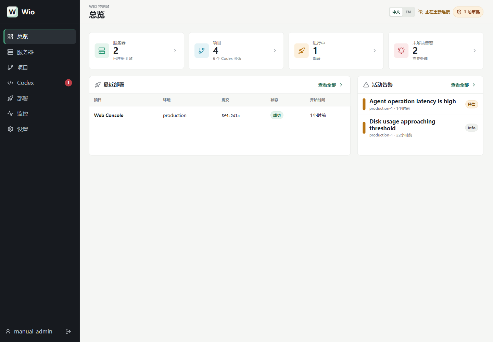

### 异步状态

| 状态 | 含义与处理 |
| --- | --- |
| `queued` / `waiting` | 请求已保存，等待 Agent、资源锁或其他前置条件；避免重复提交 |
| `delivered` | 已写入 Agent 连接，仍需等待执行结果 |
| `running` | 执行中，查看对应会话、操作结果或部署日志 |
| `succeeded` | 该操作已成功；还需结合会话轮次或部署健康状态判断整个任务 |
| `failed` / `canceled` / `cancelled` / `interrupted` | 失败、取消或中断；各资源显示名称略有不同，先读结果再重试 |
| `superseded` | 已被较新请求替代，查看最新请求的状态 |

不同资源的状态不可互相替代，例如 Codex 启动操作成功只说明轮次已被接受。写锁覆盖 Git、文件写入、Claude/Gemini 等操作；Codex 多会话可以并行，详见第 7 节。

## 2. 初始化与首次配置

### 创建管理员

首次打开页面后：

1. 输入一次性设置令牌。未配置 `WIO_SETUP_TOKEN` 时，从控制面启动日志的 `FIRST-RUN SETUP TOKEN` 记录读取 `setup_token`；未初始化前重启会生成新令牌。
2. 填写管理员用户名，默认 `admin`。
3. 选择固定密码、动态验证码/恢复码，或密码加动态验证码/恢复码。固定密码至少 12 个字符；组合方式登录必须同时提供密码和第二因素。
4. 创建管理员。启用 TOTP 时扫描二维码，将恢复码保存到服务器之外，每个恢复码只能使用一次。
5. 继续登录。Wio 是单管理员控制台，初始化后不再提供第二管理员注册。

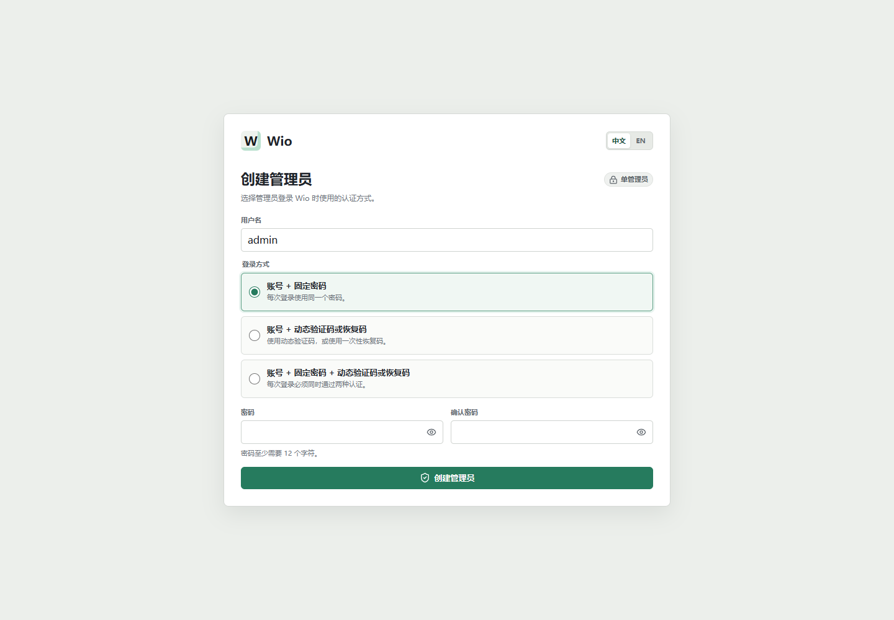

会话默认有效期 7 天。生产环境使用 HTTPS；登录失败先核对认证方式和系统时间，持续失败会触发限流。注销入口位于主导航底部。

### 推荐配置顺序

1. **设置**：创建注册所需的 Codex API 预设；需要 Git 提交/私有仓库时补充 Git 预设及姓名、邮箱。
2. **服务器**：注册主机，核对 SSH 指纹，等待 Agent 在线；使用内置控制机时先确认工具和挂载范围。
3. **服务器**：检查所需 CLI 和依赖，按需独立应用 Gemini/Claude 凭据。
4. **项目**：创建空白仓库、克隆远程或发现已有目录，检查工作区、分支与远程。
5. **AI 会话**：选择对应引擎和工作区，先手动验证模型、认证与权限。
6. **部署**：准备 Vault 密钥集，创建目标并检查预检、日志与健康状态。
7. **定时任务 / 协作**：在手动流程可用后配置所需授权和自动执行。

## 3. 凭据、CLI 与审计设置

### 创建与应用凭据预设

在 **设置 → 服务器凭据预设** 新建配置：

| 类型 | 主要字段 |
| --- | --- |
| Codex API | 名称、服务地址、模型 ID、API Key；默认地址 `https://api.openai.com/v1` |
| Gemini API | 名称、Gemini 原生 API 基础地址、模型、API Key；默认 `https://generativelanguage.googleapis.com` |
| Claude API | 名称、Anthropic Messages API 基础地址、模型/别名、API Key；默认 `https://api.anthropic.com` |
| Git HTTPS | 名称、Git 服务地址、用户名、Token/密码、提交者姓名和邮箱 |

预设中的模型由用户填写，不代表服务已验证该模型可用。保存后只显示摘要，不回显密钥。编辑已有预设时，密钥留空可保留原值。

**保存预设与应用到服务器是两步**。打开 **服务器 → 修改服务器凭据**，在 Codex API、Git、Gemini API、Claude API 页签选择配置并应用；等 Agent 成功回执后绑定才更新。编辑预设或轮换密钥后，须向所有受影响服务器重新应用。Claude 预设仅修改默认模型且 API 地址、密钥未变时，重新进入会话即可自动刷新，无须重新应用。

Codex 与 Git 独立应用要求 Agent **0.3.02+**。Git 可多选预设；全部取消会清除 Wio 托管的 Git 凭据及提交身份，应用前核对影响。仅修改 Git 不重启或修改 Codex 配置；其他引擎也有独立配置。活动任务、安装或凭据操作可能阻止切换，先按禁用原因处理。

Git 提交身份必须同时有姓名和邮箱。公开仓库可不绑定 Git 凭据进行只读访问；私有仓库、创建远程和推送还取决于凭据权限、网络及服务商限制。

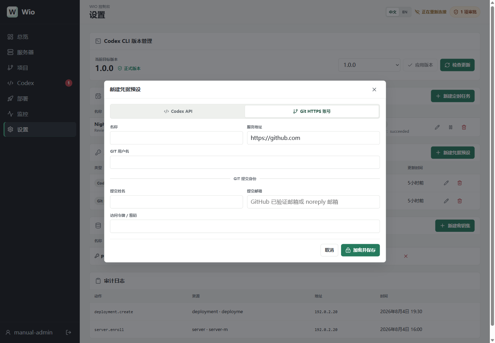

### CLI 版本管理

**设置** 分别提供 Codex、Gemini、Claude CLI 版本管理：检查官方稳定版本，选择并应用控制面目标版本。随后进入 **服务器 → 管理 AI Agent** 安装/切换具体 CLI，Codex 也可使用服务器提供的更新入口。

控制面目标版本、Dockerfile 内置版本、某台服务器的实际版本是不同层次。更改目标版本不会自动替换所有服务器；SSH 注册/修复会独立查询最新正式版。安装时先验证新版本再切换受管路径，失败保留旧选择。

缺少 Node.js/npm 时可通过 SSH 修复补装。CLI 安装完成只证明程序可运行，不能证明 API Key、模型或上游网络可用。更新 CLI 或 Agent 前先结束相关活动任务和待确认停止的进程。

### Vault 密钥集

在 **设置 → Vault 密钥集** 创建名称，并按一行一个变量填写：

```dotenv
APP_ENV=production
DATABASE_URL=...
API_TOKEN=...
```

部署目标选择密钥集后，由 Agent 在部署时使用。配置审阅只显示密钥集名称和版本。删除或修改前核对依赖目标；数据库备份必须配套保存原始 `WIO_MASTER_KEY`。

### 审计日志

设置页底部可查看认证、凭据、服务器、项目和部署等管理动作，包含资源、来源地址与时间，并可继续加载早期记录。审计日志记录管理事件；具体执行输出请看操作中心、会话或部署日志。配置了审计保留天数的实例可能已自动清理旧记录。

## 4. 服务器管理

### 注册与指纹确认

在 **服务器 → 注册服务器** 中：

1. 填写名称、扫描根目录、地址和 SSH 端口；扫描根目录使用逗号分隔，如 `/srv,/opt,/home`。
2. 使用 root 或可免交互 sudo 的 SSH 用户，填写密码或上传私钥，必要时填写私钥口令。
3. 选择必需的 Codex API 预设及可选 Git 预设；Gemini/Claude 可在注册后单独应用。
4. 按需填写硬件信息和备注。确需系统提权时才开启 **允许 Agent 与 Codex 免密使用 sudo**。
5. 点击 **检测指纹**，与主机侧或云控制台的可信 SSH SHA-256 指纹比对。
6. 确认后安装，查看实时日志与能力警告，等待 Agent 在线。

Wio 先探测主机公钥，确认后才发送登录凭据。SSH 密码和私钥不持久保存，修复或下线时需要重新提供。

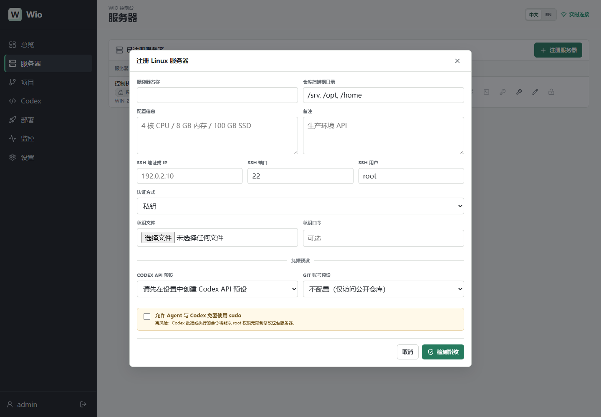

### 安装内容与能力

注册会创建 `wio-agent` 系统账号、Agent 与受限部署依赖助手的 systemd 服务、一次性注册配置和凭据。安装器尝试补齐 Git、Docker/Compose、Node.js/npm、三种 AI CLI、Playwright/Chromium，并以 Agent 账号核验。CLI 发布版本发现失败可能在远端安装前终止，需恢复控制面的发布源访问后重试。

核心注册成功不代表每项能力都可用。检查服务器列表中的心跳、Agent 版本、Codex/Gemini/Claude CLI、Git、Docker、Compose、npm 和浏览器状态；按实际需求处理警告。

外部主机只需出站连接 Wio Agent 地址，不需要开放专用 Wio 入站端口。SSH 仍需能从控制面到达，以用于安装、修复或卸载。systemd 不会自动读取交互式终端的 `.bashrc`，CLI 认证和 PATH 必须属于 Agent 运行账号。

默认 Agent 的 Home 为 `/var/lib/wio-agent`，克隆目录为其中的 `projects`。systemd 默认只允许在状态目录写入，因此扫描到 `/srv` 等项目不代表 Agent 一定有系统写权限。开启 sudo 会放宽服务沙箱并授予 `NOPASSWD: ALL`，应按实际服务器用途决定。

### 修复、升级与下线

| 操作 | 效果 |
| --- | --- |
| 编辑服务器信息 | 更新显示地址、硬件和备注等元数据 |
| 修改服务器凭据 | 独立应用各引擎和 Git 配置，成功后更新绑定 |
| 修复注册 | 重新提供 SSH 凭据，修复 Agent、依赖助手和运行依赖；保留服务器 ID 及关联资源 |
| 升级 Agent | 在线且满足自更新条件时下载匹配架构的包，校验大小与 SHA-256 后切换；活动任务可能阻止升级 |
| 管理 AI Agent | 安装或切换 Codex/Gemini/Claude CLI |
| 仅撤销记录 | 删除控制面记录、关联资源并使令牌失效；远端 Agent、文件和凭据仍可能保留 |
| 彻底下线 | 重新校验 SSH 指纹与服务器 ID，卸载服务、账号和 Agent 管理目录，再清理控制面记录 |

彻底下线会删除 `/etc/wio-agent` 与 `/var/lib/wio-agent`，其中可能包含项目、发布、原生历史和凭据；不会卸载 Docker/Git/Node.js 或删除 `/srv`、`/opt`、`/home` 等外部目录。该服务器独有且失去所有关联的项目也可能清除，其他服务器仍使用的共享项目保留。执行前阅读影响说明并备份。

内置控制机记录不能撤销；由运维人员通过 `WIO_CONTROL_AGENT_ENABLED=false` 停用。默认 Compose 给它挂载 Docker socket 和宿主机目录，容器内 root 权限及挂载边界详见[生产部署指南](PRODUCTION_DEPLOYMENT.md)。

自更新要求旧 Agent 至少为 **0.2.0**，且控制面版本高于执行端；更早版本须通过 SSH 修复重新安装。更新后的 Agent 首次连接前退出时，systemd 重启会回退到已安装版本。

## 5. 项目与工作区

### 创建、克隆或发现

在 **项目 → 新建项目** 选择：

| 方式 | 操作 |
| --- | --- |
| 空白项目 | 选择在线服务器、项目名、受管根目录内的路径、初始分支；可创建 README 初始提交并关联或新建远程 |
| 克隆 Git 仓库 | 输入远程 URL、Git 引用和目标路径；私有仓库须具备目标 Agent 可用的认证 |
| 服务器已有项目 | 扫描指定服务器的配置根目录，选择返回的 Git 仓库进行纳管；不复制现有目录 |

初始 README 提交需要 Git 姓名和邮箱。目标路径必须位于允许根目录，不能重复占用已有工作区。发现默认每次最多返回 200 个仓库；服务器离线、Git 缺失或目录权限不足时先修复条件再刷新。

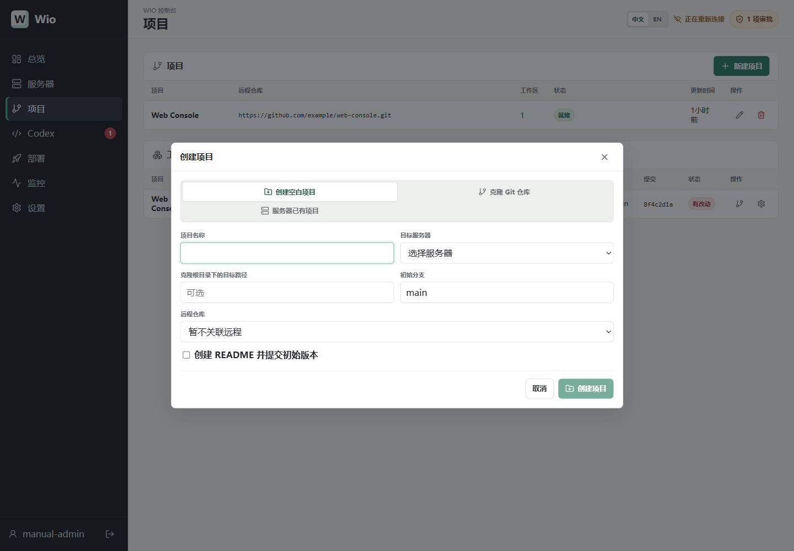

远程支持关联已有 URL，或通过 Git 预设在 Gitee/GitHub/GitLab 创建。创建失败先检查 Token 范围、命名空间、仓库重名和服务商连通性；也可在服务商创建空仓库后关联。删除 Wio 项目不会删除远程仓库。

### 查找与管理

项目按名称、服务器和项目状态筛选；工作区按路径、服务器和 Git 状态筛选。条件会保留在页面 URL 中，空列表时先检查筛选，再点击清除。

项目详情可修改名称、描述、默认分支、置顶、隐藏/恢复、归档及查看操作历史。AI 侧栏以项目和服务器分组，其名称、置顶和隐藏操作可按服务器范围生效；不要将侧栏隐藏理解为删除项目。项目就绪也不保证每个工作区所在的 Agent 在线。

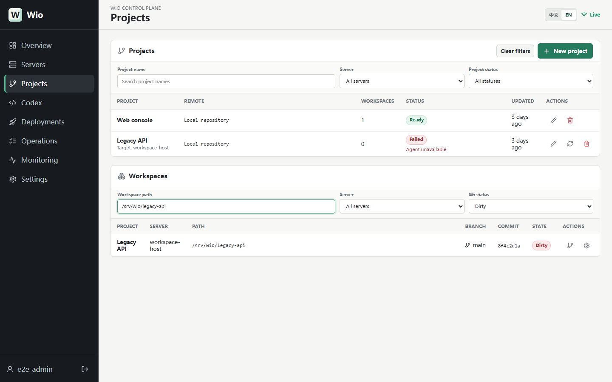

工作区管理提供：

- **重命名**：修改展示名，不改变实际路径。
- **移动**：同机移动受管目录，目标必须在允许范围内。
- **复制**：同机复制，或向其他在线服务器从项目远程重建工作区。跨服务器要求源目录干净、已检出分支、有 upstream 且已登记为项目远程；它不传输未提交文件。
- **删除**：移除记录，或删除受管文件并清理记录，按所选模式分别预检。

操作前先处理活动任务、写操作、子 worktree 和部署等阻塞项。创建 worktree 选择基准 Git 引用和新分支，文件来自基准提交，不自动复制源目录未提交或忽略的文件。

### 删除预检

项目或工作区删除会列出管理模式、脏文件、活动操作、会话、子工作区和部署等影响。两种模式分别是：

- **仅删除元数据**：移除 Wio 记录，服务器目录保留；会话和部署等关联记录可能随之清除。
- **删除受管文件**：删除允许管理的实际目录；`observed` 目录不能使用此方式，存在未处理工作区时项目记录可能保留。

核对阻塞原因和范围，按页面要求输入名称后确认。物理删除、丢弃改动和下线均不能由 Wio 自动恢复。

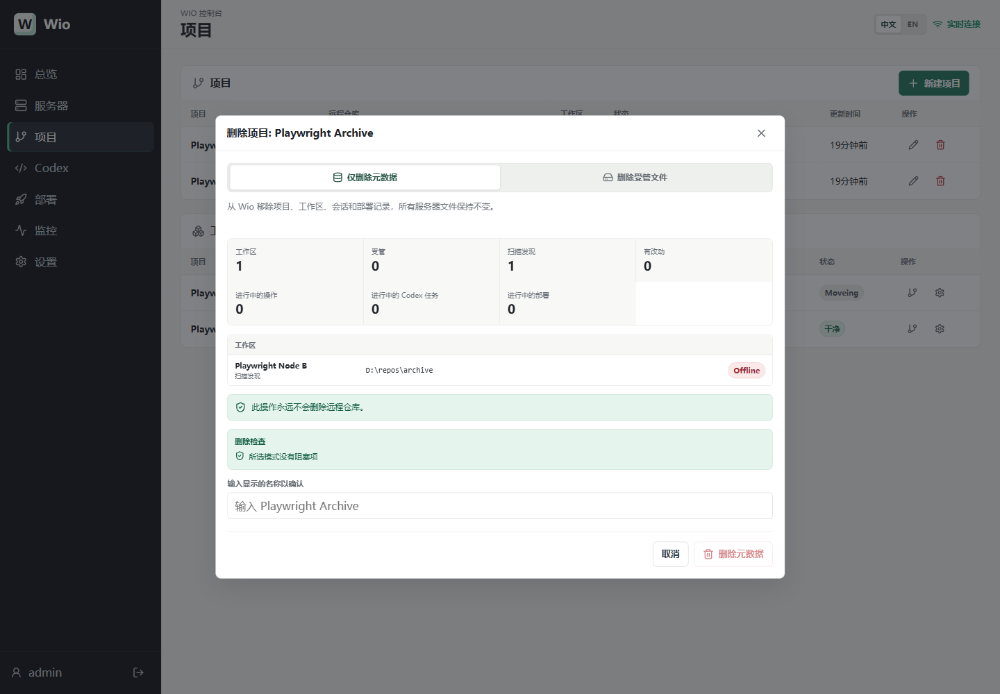

## 6. Git 与文件操作

### Git 信息与同步

在工作区打开 **Git 信息** 并刷新，可查看当前分支、HEAD、upstream、ahead/behind、暂存/未暂存/未跟踪文件，以及分支、远程、提交列表和详情。

支持新建/切换/重命名/删除分支，添加/编辑/删除 remote，fetch、pull、push、设置 upstream、暂存/取消暂存、丢弃和提交。具体入口分布于 Git 对话框与会话的文件变更面板。

- Fetch 更新远程引用；Pull 会修改当前分支，脏目录需先处理。
- 首次 Push 可设置 upstream，失败时检查远程权限、非快进和本地分支状态。
- 提交前核对范围和提交者身份。文件面板的提交入口会提交当前改动，先检查是否包含不应提交的文件。
- 删除当前分支或尚未合并分支会受保护；只在明确处理内容后选择强制选项。

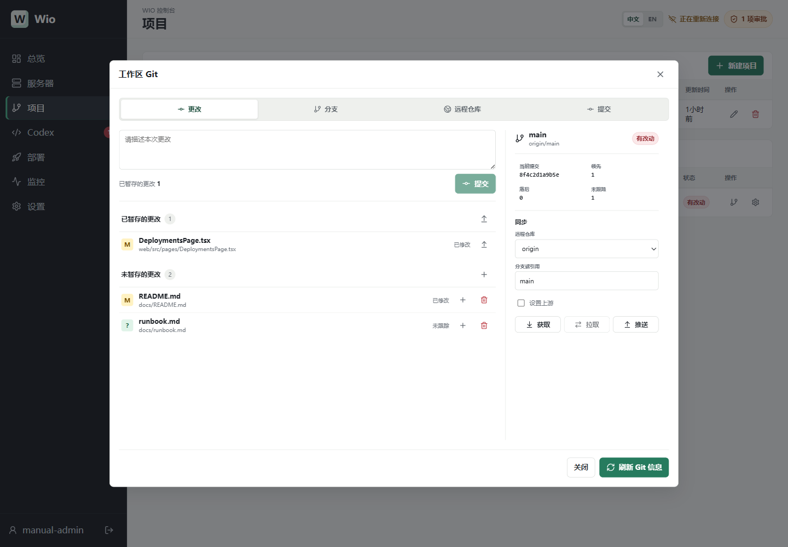

### 文件树、预览与编辑

三种 AI 页面共享工作区文件与变更面板：

1. 切换 **项目文件 / 文件变更**，刷新扫描并选择文件。
2. 文本预览提供高亮；JPG/JPEG、PNG、GIF、WebP 图片可直接查看，支持自适应显示和原始尺寸切换，图片预览上限为 **4 MiB**。diff 显示新增、删除和冲突，截断时按页面提示处理。
3. 在可写工作区新建文件、上传文件或编辑完整文本。新建/上传和文本编辑上限为 **1 MiB**；文本预览/diff 默认也限制为 1 MiB，截断或不可编辑的内容不能直接保存。
4. 编辑后保存，等待 Agent 成功回执。保存会校验读取时的文件哈希；文件已被其他进程改动时，应重新读取并合并。
5. 需要时提交、pull、push，或确认后丢弃单个文件改动。

文件写入需要 Agent **0.2.56+**，并遵循管理模式、在线状态和工作区写锁。路径会解析并检查边界；不能使用 `..` 或符号链接逃出工作区。草稿不要依赖浏览器长期保存，刷新或退出前处理未保存修改。

扫描或预览卡住可到操作中心中断对应读取操作，再重新刷新；中断不撤销文件改动。

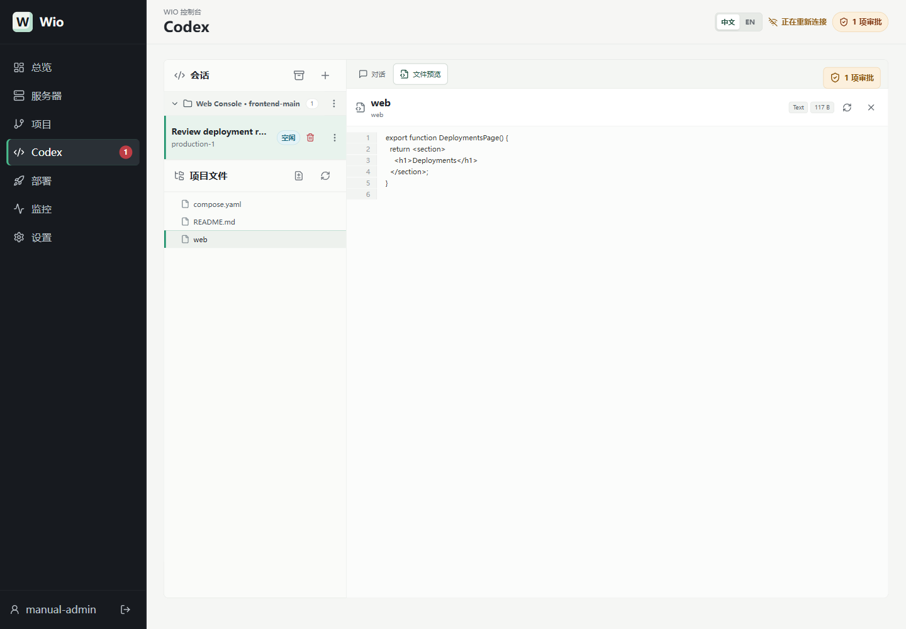

## 7. AI 会话通用操作

### 能力对照

以下为控制面及 Agent/CLI 均满足条件时的能力：

| 能力 | Codex | Gemini | Claude |
| --- | --- | --- | --- |
| 原生续聊、图片、工具输出、归档 | 支持 | 支持 | 支持 |
| 模型与思考程度 | CLI 模型能力及推理强度 | 模型支持的 thinking 等级 | CLI `--effort` |
| 网页工具审批 | 支持 | ACP 支持 | 暂不提供，需审批的工具可能拒绝 |
| 会话内提问 | 支持 | 支持 | Agent 0.2.98+、CLI 2.1.286+ |
| 运行中追加指令 | 原生 steer | 下一次模型请求送达 | 原生双向输入 |
| 消息编辑重发 / 原生分支 | 支持 | 支持 | 支持，消息边界有限制 |
| Goal | 原生能力，按 CLI 支持开放 | Wio 自动续行编排 | 暂不提供 |
| 技能 | 读取与使用 | 读取、使用及安装/启停/卸载 | 原生技能发现与使用 |
| 定时任务 / 授权会话协作 | 支持 | 支持 | 支持 |

### 创建与日常使用

进入引擎页面，在侧栏顶部 **＋** 选择工作区，或在已有项目菜单/当前对话顶部新建会话。检查服务器、路径、模型和权限后发送任务。Enter 发送、Shift+Enter 换行；可粘贴或通过入口添加 PNG/JPEG/WebP 图片，每次最多 **4 张、单张 2 MiB、总计 4 MiB**。

三种引擎均支持展示截图工具返回的内嵌图片，以及消息中引用的工作区图片。点击图片可在弹窗中放大查看，切换自适应显示或原始尺寸；按 Escape、点击关闭按钮或弹窗外部可关闭。工作区图片引用遵循文件路径边界，单张读取上限为 **4 MiB**。

模型列表与服务器实际 CLI/已应用 API 配置关联，可刷新或输入自定义模型。没有列表不代表自定义模型不可用；有列表也不保证当前账号额度和权限足够。切换参数通常在下一轮生效；运行中追加沿用当前轮次设置。

侧栏可搜索、重命名、置顶、归档/恢复、复制路径/ID/会话链接。归档会话只读。删除 Wio 会话不会删除项目文件，也不会自动清理 CLI 的原生历史。

### 续聊、分支和编辑的区别

| 操作 | 对话上下文 | 文件 |
| --- | --- | --- |
| 新建会话 | 从空上下文开始 | 使用所选工作区当前文件 |
| 在原会话继续 | 恢复该 CLI 原生历史 | 使用当前文件 |
| 继续到新任务 / 分支到新聊天 | 复制支持边界内的原生历史，原聊天保留 | 默认仍共享原工作区 |
| 继续到新 worktree | 复制会话上下文并建立独立 Git 工作目录 | 来自所选基准提交 |
| 编辑并重新发送 | 保留此前上下文，替换该消息并舍弃之后的对话 | **不回退已修改文件** |

分支边界因引擎而异，见后续各节。编辑重发需要空闲、在线、未归档且原生历史可恢复；准备失败保留旧对话。仅在控制面保存消息不足以恢复原生会话，应保留 Agent 的 CLI 历史目录。

### 并发与停止

同一会话一次运行一轮。不同 Codex 会话可在同一工作区并行；Claude/Gemini 与使用工作区写锁的 Git、文件等操作互斥。**Codex 不使用该写锁**，不要依赖它防止跨引擎同时修改同一目录；需要独立修改时创建 worktree。

点击停止后，应等待真实退出确认。中断和失败均不回滚文件。Agent 失联、重启或旧进程状态无法确认时，Claude/Gemini 等会话可能保持待确认状态；先在目标主机核实进程退出，再使用 **确认进程已停止**，不要仅凭页面无新输出释放工作区。

## 8. Codex

### 模型、审批与提问

Codex 需要目标 Agent 在线、Codex CLI 可运行且认证有效。网页托管流程使用服务器已应用的 Codex API 预设。模型列表从目标 CLI 的 `model/list` 获取，不依赖前端固定型号；可选服务器默认或自定义模型。

明确模型后，推理强度按 CLI 返回能力展示，包括其支持的 `ultra` 等取值；切换模型会将不兼容的强度调整为默认。服务器默认或自定义模型仍可按页面指定强度，最终以实际模型支持为准。

选择按请求审批、不可信命令需审批或永不审批。出现审批卡片时核对命令、目录和影响后批准/拒绝；提问卡片按提供的选项和自定义文字要求回答。Agent 会为普通会话启用提问能力，仍受 CLI 支持约束。

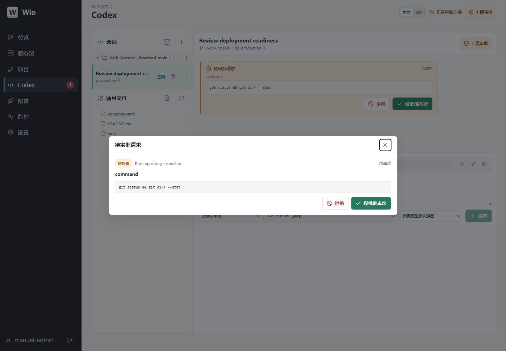

### 追加、分支与扩展能力

Agent **0.2.51+** 可在轮次真正开始后追加文字/图片，使用原生 `turn/steer`。启动排队时需等待；轮次已结束时追加会被拒绝，检查失败提示与草稿后再发送。

Agent **0.2.59+** 可在已结束轮次的最终回复菜单选择 **分支到新聊天**，保留至该轮的上下文。原聊天保留，新聊天默认共享工作目录；需要隔离时选择新 worktree。

Goal、token budget、计划模式、MCP、Skills 和限额状态按 CLI 实际能力开放。不支持时页面会说明；Wio 不用提示词替代原生接口。目标状态或模型自述完成仍需结合文件、测试和执行日志验证。

Codex 每个会话使用独立 app-server，空闲约 5 分钟后回收进程，下一次发送恢复原生历史。CLI 更新和 Codex 凭据应用需等待活动任务结束。Codex API Key 仅注入模型子进程，Git、扫描、Compose 不继承它。

## 9. Gemini

### 接入、模型与权限

在 **设置** 创建 Gemini API 预设，并在服务器的 Gemini API 页签应用。也可使用 Agent 账号已有 Google 登录或服务环境认证，具体配置见 [Gemini 接入参考](GEMINI.md)。模型发现当前使用已应用的 API 预设，登录/Vertex AI 模式可手动输入模型。

模型选择来自上游实际列表，`auto` 使用已应用配置的默认模型或由 CLI 选择。普通支持模型可设置 minimal/low/medium/high，模型名已带固定等级后缀时按模型预设显示；Gemini 3 Pro 仅提供 low/high。默认模式不覆盖 CLI 原有思考配置。

工具权限包括默认、允许编辑和永不审批，分别对应 `default`、`auto_edit`、`yolo`。ACP 可将审批请求和提问展示在网页中；允许编辑不代表所有命令都获批，yolo 仍受账号和管理员策略限制。

### 追加、历史与技能

- 运行中追加文字要求 Agent **0.2.79+**、CLI **0.66.0+**，在下一次模型请求时送达。Agent **0.2.88+** 可追加图片，只有模型实际读取才显示送达。未送达内容不会自动转为下一轮。
- 编辑重发要求 Agent **0.2.85+**、CLI **0.65.0+**；分支要求 Agent **0.2.68+**、CLI **0.65.0+**。回复菜单只对已成功完成轮次的最终回答提供分支入口。
- `/skills` 打开技能面板。安装、启停、卸载要求 Agent **0.2.88+**、CLI **0.66.0+**；安装来源可为 HTTPS Git 仓库或当前项目内路径，支持项目/Agent 账号范围。账号范围影响该账号其他项目，卸载前核对范围；内置或扩展技能不直接卸载。
- `/plan` 按 Agent/CLI 能力开放。对话可导出 Markdown，包含完整已保存历史、工具结果和用量；缺失用量显示不可用，不补成零。

### Goal 目标模式

Agent **0.2.84+**、CLI **0.66.0+** 支持 `/goal 目标描述`，可附图片，设置本次最多自动续行 **1–100 次**、运行 **1–1440 分钟**。Wio 在同一原生会话检查每轮结果，未报告完成则在限制内继续；这属于 Wio 编排。

目标卡可暂停、恢复或取消；普通停止也会暂停目标。达到限制、执行失败或没有完成报告时需人工处理。等待审批/回答也计入时长。卡片完成要求模型报告完成且操作正常结束，证据仍需用户核验；当前不提供精确 token 硬预算。

Agent **0.2.88+** 会在连续 3 轮可见输出/工具记录重复或为空，或连续 8 次相同工具调用返回相同结果时停止自动执行。两分钟无可见进展会显示等待提示，单纯等待不代表已卡死。检查后可恢复目标，恢复时可重新设置本次限制。

当前控制面 Dockerfile 内置 Gemini CLI 为 **0.65.0**，使用上述 `0.66.0+` 功能前须更新 CLI；仅升级 Wio Agent 不够。

## 10. Claude

### 接入、模型与权限

在 **设置** 创建 Claude API 预设，默认 `https://api.anthropic.com`，或填写兼容 Anthropic Messages API 的代理基础地址；在服务器 Claude API 页签应用。未应用托管预设时，可使用 Agent 账号已有 CLI 登录或环境认证，见 [Claude 接入参考](CLAUDE.md)。

模型列表从已应用凭据的 `/v1/models` 获取，支持自定义别名/模型 ID；仅使用 CLI 登录时保留默认别名和自定义输入。思考程度对应 CLI `--effort low|medium|high|xhigh|max`，默认不传覆盖，是否支持取决于 CLI/模型。

权限对应默认、允许编辑、计划和跳过权限检查（`default`、`acceptEdits`、`plan`、`bypassPermissions`）。**网页暂不提供 Claude 工具审批**：需要确认的工具可能被拒绝；跳过检查仍受系统权限约束。会话内 `AskUserQuestion` 是独立能力，Agent **0.2.98+**、CLI **2.1.286+** 可显示单选、多选及自定义答案，等待时仍可停止任务。

### 追加、分支、技能与用量

- 运行中追加文字/图片要求 Agent **0.2.95+**、CLI **2.1.286+**。沿用同一进程与当前参数；状态区分已排队、已接收、已用于回复和未确认。回显已接收不等于已参与回答，不能对未确认内容盲目重复发送。
- Agent **0.2.97+** 支持编辑重发及消息分支。**分支到新聊天**仅出现在最后一次 Claude 回复、且没有更新用户输入的位置；更早上下文可按可用入口处理。复制快照后，首次发送才生成新原生会话 ID。
- `/skill` 打开原生技能与提示命令，Agent **0.2.94+** 可主动发现并刷新；手动输入 `/skills` 也可打开。技能由 Claude Code 原生展开，Wio 未提供 Gemini 式的安装管理。
- 输入 `/` 可选模型、思考、权限、计划、新建、分支和定时命令。交互式终端专用命令不保证在无头模式可用。
- 会话标题下的累计用量来自完整已保存主会话轮次，输入含缓存创建/读取，不包含子代理或辅助模型；平均输出速度包含工具等待时间。记录缺失时显示不完整，不以零补齐。
- Agent **0.3.03+** 上报原生上下文压缩状态及实际提供的前后 token 数；压缩不会清零会话累计用量。

Claude 暂不提供 Goal。图片、编辑和停止等操作仍遵守第 7 节的限制，消息回退不会还原项目文件。

## 11. 会话协作

控制端与参与 Agent **0.3.06+** 为三种引擎注入协作工具，无需手工配置 MCP。创建的是正式 Wio 会话，可在页面打开、接管和继续。

1. 打开对话顶部 **会话协作设置**，开启 **允许模型创建和管理子会话**。
2. 按任务需要授权本项目其他工作区、独立 worktree、跨模型执行权限、进一步委派和自动续聊。
3. 在任务中明确分工、目录和验收方式，例如“创建 Claude 子会话，在独立 worktree 检查测试，完成后给出结果，不提交”。
4. 从协作卡片检查请求状态、父子链接、未读结果和失败原因。仅创建空会话不会调用模型；创建成功也不代表任务完成。

默认沿用当前项目、服务器、工作区和引擎设置。跨模型必须明确授权目标执行权限；原生分叉只用于同类引擎，跨模型通过明确交接说明传递上下文。

共享目录会共享文件。当前轮次持有写锁时，共享目录的 Claude/Gemini 子任务会等待该轮结束；独立 worktree 在满足条件时可以在本轮内执行并等待。`after_turn` 分叉依赖来源轮次结束，不能一边阻止其结束一边等待它完成。

默认同时活动子会话最多 **2 个**；进一步委派默认关闭，开启后最多 **2 层**；自动续聊默认关闭，每个根任务最多 **10 次**。自动续聊还须具体请求启用，且父会话空闲、未归档、授权有效。中断一个会话不会级联停止子会话，已提交任务需分别处理。

超时/断线后按原请求编号查询，避免换编号重复创建。授权范围、工具参数、等待环和执行证据说明见[会话协作协议](SESSION_COLLABORATION.md)。

## 12. 定时任务

三种引擎均可通过会话菜单的 **创建定时任务**，或 **设置 → 定时任务** 创建。任务复用已有会话及其原生历史，不会每次新建空会话。

填写任务名、引擎/会话、提示词、频率、IANA 时区和执行时间。支持每天、工作日、每周、每月、固定间隔、自定义表达式；新建表单默认取浏览器时区，无法读取时使用 `UTC`。请显式核对所需时区，例如 `Asia/Shanghai`，不要把服务器或当前浏览器时间当作任务时区。可覆盖模型和该引擎支持的思考程度、工具权限，留空选项按页面规则跟随会话。

设置中可编辑、启用/停用、删除，查看下次时间和最近执行结果。服务器离线、会话归档、忙碌或工作区不可用时会跳过本次，等待下一计划时间，避免重叠；查看“跳过/失败”的原因后处理。

先手动验证任务与权限，再启用调度。定时执行不能依赖有人在网页回答或审批，需要交互的动作可能失败。停用只阻止未来触发，已经开始的轮次应到对应会话停止。

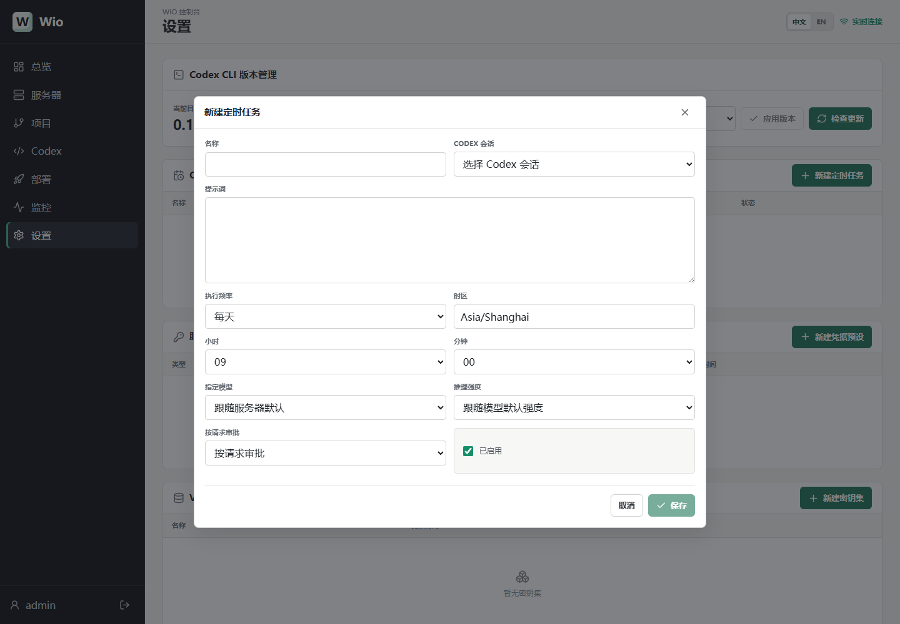

## 13. Docker Compose 部署

### 创建目标与预检

在 **部署 → 新建目标** 选择已有工作区或远程仓库来源，填写：

- 项目、在线服务器、工作区或远程 URL，以及环境名称。
- Git 引用、Compose 文件名（默认 `compose.yaml`）、构建或拉取镜像方式。
- 可选 Vault 密钥集、外部访问端口/域名和健康检查地址。

Agent 预检 Linux、Git、Docker daemon、Compose、目录权限及来源。缺少 Compose 时，`auto` 模式可匹配受支持的版本化模板，在隔离 release 生成配置；无法确定类型时明确失败。缺失依赖时受限助手可尝试固定安装步骤，既有服务器未安装助手需通过 SSH 修复。

当前自动模板支持包含 `pnpm-lock.yaml` 的 Vite 静态站点，以及 Vite 前端加 Node.js HTTP/WebSocket 服务，仅支持本机构建。其他项目或拉取镜像场景应自行提供 Compose 文件；自动模板不是通用应用部署器。

发布使用独立 release，不直接在开发工作区执行 Compose。Wio 记录实际解析的 commit；生产建议使用明确 commit 或 tag。

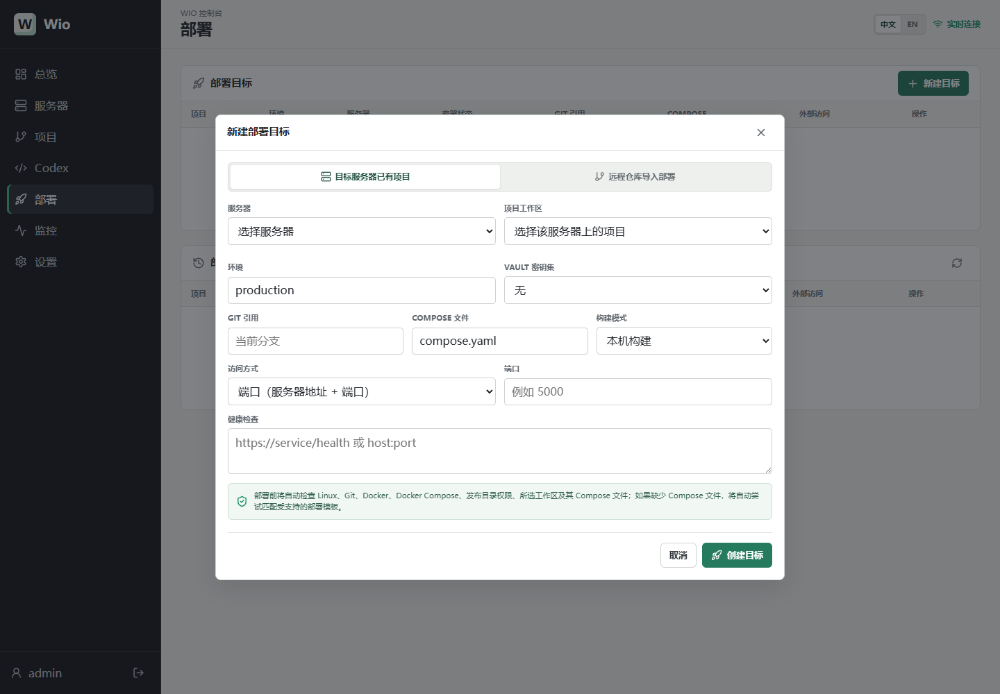

### 配置审阅与日志

编辑目标时，**配置审阅** 对比当前配置与最近成功部署快照，包含来源、环境、服务器、Git 引用、Compose、访问地址、健康检查、密钥集名称/版本。没有成功基线时会明确提示，不能理解为“配置一致”。

点击部署后，查看阶段日志、commit、起止时间和健康检查。历史中的不可变配置快照说明当次实际配置，目标后续修改不会覆盖它。失败先读最后失败事件，修复明确原因后再部署。

HTTP(S) 检查以 2xx/3xx 为成功，TCP 检查以连接成功为准；默认 60 秒内每 2 秒重试。检查发生在 Agent 所在环境，地址须从该环境可达。

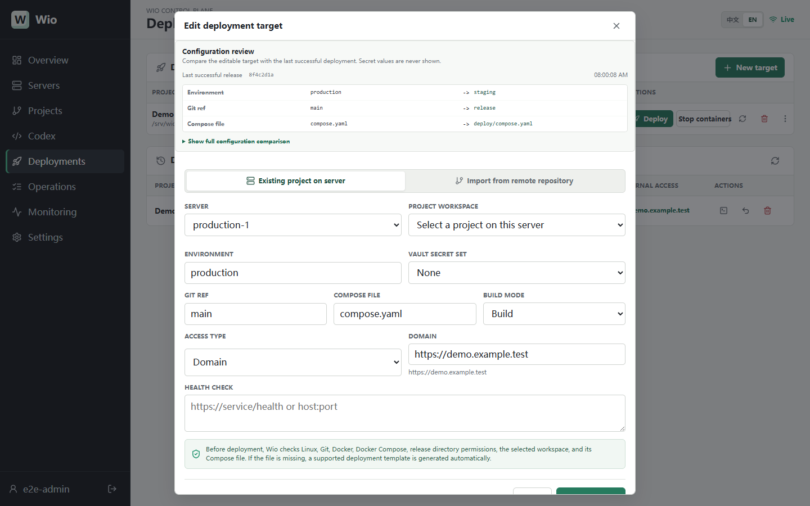

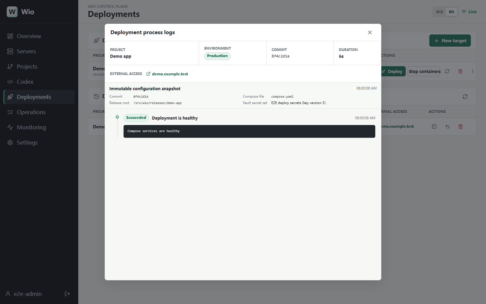

### 访问、容器与回滚

外部访问 URL 是访问入口记录。未设置时，成功部署可根据首个非回环 TCP 发布端口与服务器地址生成链接；它不自动配置 DNS、防火墙或现有 Compose 端口。自动模板的端口模式可生成端口映射，域名模式仍需外部代理路由。

| 操作 | 行为 |
| --- | --- |
| 启动 / 停止 / 重启 | 操作当前 Compose 应用 |
| 移除容器 | `docker compose down --remove-orphans`；保留命名卷、release 和历史，之后可重新启动 |
| 回滚到上一版本 | 使用上一个可用成功版本的快照 |
| 回滚到此版本 | 从历史选择具备快照的成功版本，确认目标 commit |
| 删除目标 | 清理部署目标配置及相关记录；按确认页核对影响，不等于已卸载应用 |

回滚使用保存的不可变镜像 ID，禁止重新构建或拉取；镜像已清理会失败，旧历史缺少快照时需重新发布。回滚不撤销数据库迁移或数据卷内容。指定历史回滚要求 Agent **0.2.45+**。

同一目标的部署与容器操作互斥，等待当前操作结束再进行下一项。日志会脱敏，但仍应避免应用主动打印密钥。

## 14. 操作中心、监控与告警

### 操作中心与中断

操作中心展示近期操作的资源、服务器、类型、状态、最近结果和时间，支持筛选和跳转。当前列表最多取 200 条，不能当作完整审计归档。

Agent **0.2.96+** 可中断 Git 检查、仓库扫描、文件扫描、变更扫描、文件预览、diff 预览。点击后显示 **中断中**，直到 Agent 确认退出才更新目标状态；恰好已完成时保留实际结果。离线时请求等待重连处理。

15 秒仍无法确认停止时，中断请求可能失败，原操作保持执行状态，可按提示重试。此入口不处理 AI 轮次、部署、升级、凭据或文件写入，这些操作使用各自流程。详细回执行为见[运维参考](OPERATIONS.md)。

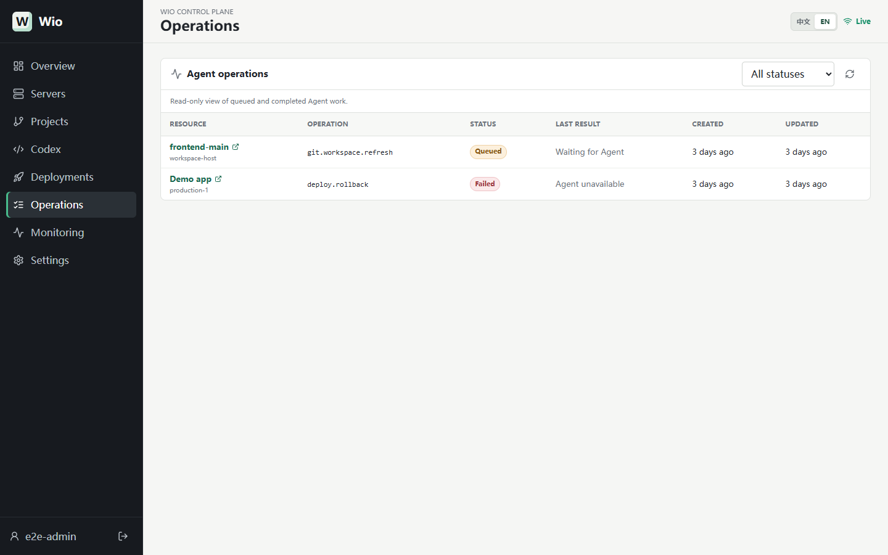

### 指标与告警

Agent 默认每 **15 秒**发送心跳/指标、每 **2 分钟**更新仓库清单。监控可选择服务器及 1 小时、6 小时、24 小时、7 天范围，查看 CPU、内存、根文件系统磁盘、1 分钟负载和网络收发速率。控制面按分钟聚合，趋势图不能替代主机精确诊断。

CPU/内存/磁盘连续 3 个样本达到 90% 触发告警，CPU/内存为 warning，磁盘为 critical；回落后自动解决。确认告警只记录处理状态，不会修复主机。

操作延迟区展示队列等待、投递与执行耗时的平均、P95、最大值；队列等待 2 秒和执行 30 秒是页面标注的告警阈值，连续 3 次越界后触发 warning 告警，回落后自动解决。长时间上升时结合 Agent 心跳、近期结果和服务器资源排查。

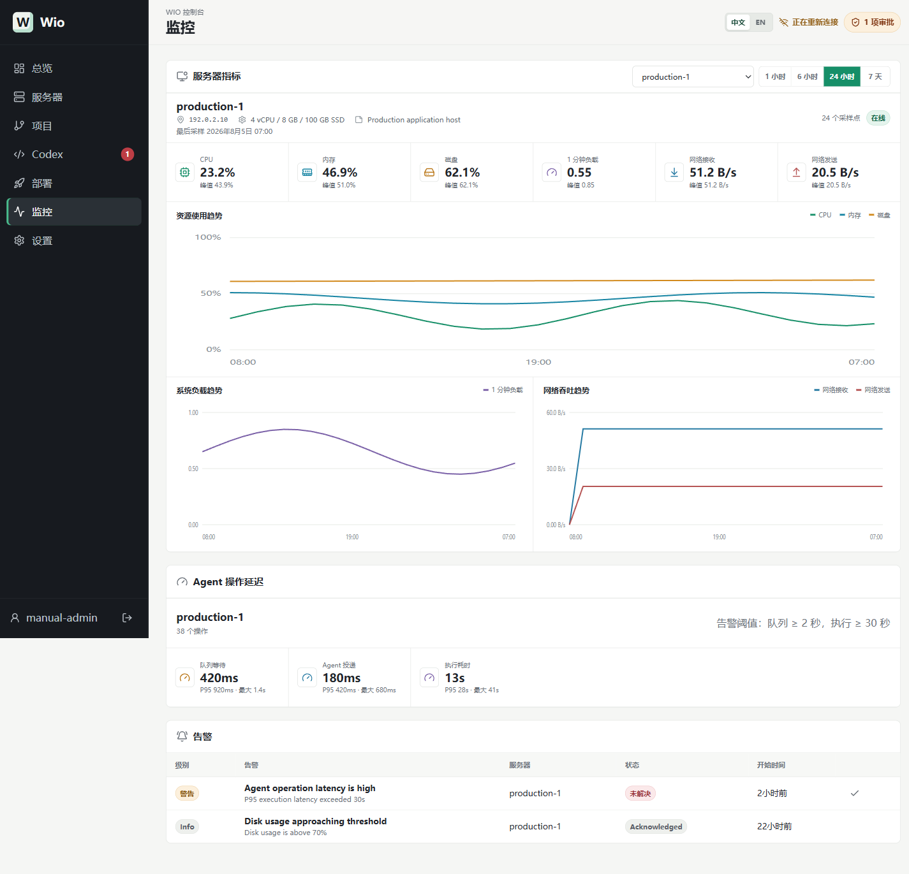

监控数据按 7 天清理；审计和可清理操作历史默认永久保留，可由运维人员配置保留天数。会话历史和部署依赖等受保护记录不按通用操作保留策略直接删除。

## 15. 故障处理与备份

### 常见问题

| 现象 | 检查与处理 |
| --- | --- |
| 找不到首次设置令牌 | 查看控制面最新启动日志的 `setup_token`；预设 `WIO_SETUP_TOKEN` 时日志不回显，使用预设值 |
| 登录后会话失效或 Cookie 不生效 | 核对实际 HTTPS 地址、`WIO_PUBLIC_URL` 和代理配置，生产不要开启开发 insecure 选项 |
| 页面实时连接正常但服务器离线 | 浏览器链路与 Agent 链路独立；从目标主机检查控制面出站访问和 `wio-agent` 服务 |
| 已注册但 Git/部署/模型不可用 | 查看能力告警；核对依赖、系统权限、Docker 服务以及该引擎认证，不要仅看“在线” |
| 编辑预设后仍用旧模型/密钥 | 重新向服务器应用预设，等待成功；有活动任务时先结束再切换 |
| 新功能按钮不可用 | 同时检查控制面、Agent、CLI 版本和忙碌状态；内置镜像 CLI 也可能需单独升级 |
| 扫描、预览持续加载 | 查看操作中心结果；可中断的读取先确认停止再刷新，不重复排队 |
| Claude 工具被拒绝 | 网页暂不提供工具审批；核对权限模式和系统策略，会话提问可用不代表工具审批可用 |
| 会话无法续聊/分支 | 核对原服务器、运行账号、原生会话目录和版本；仅有 Wio 数据库消息不足以恢复 |
| 长任务没有新输出 | 结合工具、模型网络、提问/审批和日志判断；有等待提示不代表进程已死 |
| 重启后显示进程待确认 | 在主机侧核实原进程退出后再确认，不自动重放写任务 |
| 部署成功但外部地址不可达 | 从 Agent 检查健康地址，再核对 Compose 端口、代理、DNS、防火墙；访问链接不会配置这些资源 |
| 定时任务没有执行 | 查看最近状态、时区、下次时间、是否启用，以及会话是否离线/归档/忙碌 |

外部 Agent 可在目标主机查看 `systemctl status wio-agent` 和 `journalctl -u wio-agent`；容器内置 Agent 查看控制面容器日志。记录故障时间、服务器、工作区和操作/会话 ID，以便对照审计及执行输出。

### 备份与恢复

必须配套保存控制面数据库、原始 `WIO_MASTER_KEY` 与生产环境配置。还应备份：

- 内置 Agent 状态卷；外部 Agent 的 `/etc/wio-agent`、`/var/lib/wio-agent`。
- Agent 账号实际使用的 Codex/Gemini/Claude 原生历史与认证目录；默认 Home 下的 `.codex`、`.gemini`、`.claude`，自定义时使用实际路径。
- 重要工作区、release、应用持久数据卷，以及 Caddy 证书/配置卷。

这些目录含凭据和令牌，应加密保存到主机之外。Wio 数据库保存页面历史，CLI 目录用于原生恢复，两者不能互相替代。数据库备份命令和部署恢复注意事项见 [README 的备份说明](../README.md#备份与安全)及[生产部署指南](PRODUCTION_DEPLOYMENT.md)。

清理项目前，先停止/等待三个引擎的任务和其他活动操作，检查 Git 状态、部署和子 worktree，再使用预检选择记录或文件删除。不要将归档、隐藏、中断、回滚部署视为文件和数据备份。
