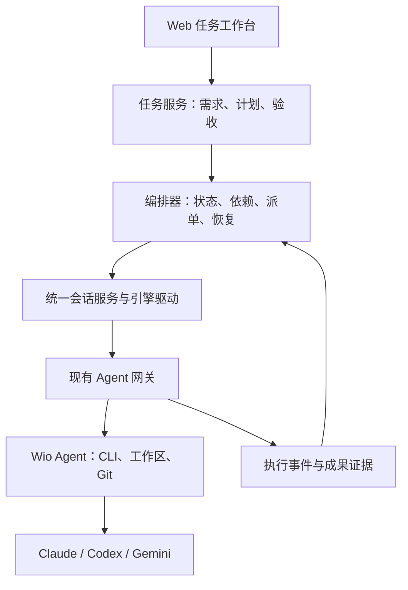

# P7 任务编排与团队协作

返回[路线图总览](README.md)。状态以总览的“进度总表”为准，本文件写设计边界、步骤和执行记录。

方向确认：2026-11-14，决策 D10、D11。Wio 继续作为主体，参考 OpenTeams 的设计，在现有 Go 控制面和 React 前端内补齐任务层。本阶段是新增产品能力，不属于保持行为不变的重构。

本阶段补充盘点基线为 Wio 提交 `65b5753`，版本 0.3.12；P0 至 P6 的历史基线仍以总览为准。下面的类型、模块和接口均为待实现设计，最终契约由 P7-01 固化，不能作为当前功能说明。

## 目标与交付顺序

目标流程：用户创建需求；协调成员拆解计划；开发和研究成员并行执行；开发完成后请求审查；审查不通过则有限返工；协调成员汇总，用户最终验收。Claude、Codex、Gemini 均可承担任一角色，角色不与引擎绑定。

按三批交付，每批都能独立使用：

| 里程碑 | 步骤 | 用户得到什么 |
| --- | --- | --- |
| M8 任务闭环 | P7-00 至 P7-04 | 创建任务、记录验收条件，执行明确的依赖计划，看到步骤状态、阻塞原因和关联会话 |
| M9 成果与审查 | P7-05、P7-06 | 审查指定版本的成果，返工后重新验证，最终由用户接受或拒绝 |
| M10 动态协作 | P7-07 至 P7-09 | 成员能请求审查、补充步骤或调整计划，平台校验后调度；可查看和编辑任务图 |

首批使用表单和步骤列表录入、确认计划，不要求模型自动生成计划或提供图形编辑器。跨服务器执行复用现有 Agent；跨服务器的代码和文件交接到 P7-05 才交付，首批只安排具备明确输入的步骤，不假设目录共享。

## 当前基础与缺口

已有基础见[会话协作协议](../SESSION_COLLABORATION.md)：

- 三种引擎的正式会话、跨引擎创建/交接、消息发送、追加指令、中断和按执行操作读取结果。
- 稳定请求编号与重试对账、持久化的 worktree 准备、排队和自动续聊。
- 来源身份绑定、授权范围、跨引擎权限映射、委派深度、活动子会话限制和等待环检测。
- 工作区、Git Worktree、执行事件、页面通知及原生会话链接。

这些能力尚未表达任务的验收条件、计划依赖、成果版本、审查结论和任务整体完成状态。会话空闲、操作成功或模型文本声称完成，都不能代替任务验收。现有等待环检测也不能限制成员不断要求对方返工的业务循环。

## 参考 OpenTeams 的范围

参考仓库：[openteams-lab/openteams](https://github.com/openteams-lab/openteams)，固定设计参考提交 [`59048236b6fd4a3760ec8a2991909d23ee78cc97`](https://github.com/openteams-lab/openteams/tree/59048236b6fd4a3760ec8a2991909d23ee78cc97)。本次依据源码和文档静态评估，未对上游做真实模型端到端验收。

| 参考内容 | Wio 的落点 |
| --- | --- |
| 计划与版本、编译后的步骤和依赖 | 任务计划版本、计划校验和就绪步骤计算 |
| 集中的状态迁移、事件和运行投影 | 控制面的任务状态机、条件更新、事务事件和页面读模型 |
| 团队成员、结构化消息和共享记录 | 任务内的角色、协作请求与可追溯上下文 |
| 成果、审查、修复循环和用户验收 | 版本化成果、绑定版本的审查与有限返工 |
| 工作流图和运行记录界面 | Wio 的任务工作台，复用现有会话外壳和深链 |

参考入口：[编译器](https://github.com/openteams-lab/openteams/blob/59048236b6fd4a3760ec8a2991909d23ee78cc97/crates/services/src/services/workflow/compiler/compiler.rs)、[编排器与 reducer](https://github.com/openteams-lab/openteams/tree/59048236b6fd4a3760ec8a2991909d23ee78cc97/crates/services/src/services/workflow/orchestrator)、[结构化协作消息](https://github.com/openteams-lab/openteams/blob/59048236b6fd4a3760ec8a2991909d23ee78cc97/crates/services/src/services/chat_runner/protocol.rs)、[worktree 状态机](https://github.com/openteams-lab/openteams/blob/59048236b6fd4a3760ec8a2991909d23ee78cc97/crates/services/src/services/session_worktree.rs)。

上游自由聊天的成员直发与工作流的统一调度有不同边界；消息租约和崩溃恢复增强在其[实施计划](https://github.com/openteams-lab/openteams/blob/59048236b6fd4a3760ec8a2991909d23ee78cc97/docs/chat-delivery-runtime-outbox-implementation-plan.md)中仍有待实现项。Wio 必须独立定义权限和恢复契约，不把参考实现视为已经验证的分布式调度保证。

本方向只参考设计，不复制上游源码、技能、素材、数据库迁移，也不引入其 Rust 服务、桌面壳或本地执行器。如后续决定复用具体代码，另行记录来源、许可证和改动范围。

## 设计边界

### 模块与职责

建议新增 `internal/task` 放领域类型与纯校验，`internal/taskservice` 放状态迁移和调度；`internal/store` 负责数据访问和事务。接口、包名以 P7-01 的依赖设计为准。三种引擎的差异继续由 P2 的驱动和能力对象处理，任务服务不复制适配器或在控制机直接启动远程工作区的 CLI。

现有 `internal/scheduler` 执行定时任务；任务编排器按依赖和事件推进。两者通过会话服务复用执行入口，不以定时任务表表达任务 DAG。

### 核心对象

| 对象 | 职责与关联 |
| --- | --- |
| Task | 项目内的需求、验收条件、预算、当前计划和最终验收记录 |
| PlanRevision | 不可变的计划快照，保存步骤、依赖、作者、依据和变更理由 |
| TaskRun | 一次计划执行，绑定计划版本；保存暂停、失败、取消和用户验收结果 |
| TaskMember | 任务内角色、引擎与执行设置、允许的工作区和会话引用 |
| Step | 一个开发、研究、审查或汇总工作单元，保存输入、输出、依赖与执行状态 |
| Attempt | 步骤的一次尝试，绑定会话引用、实际操作 ID、幂等键、调度所有权和结果游标 |
| ArtifactRevision | 不可变的成果清单，关联尝试、代码基线、commit/patch/文件摘要和验证证据 |
| Review | 对指定成果版本和验收条件的审查记录，保留意见和通过/拒绝结论 |
| CollaborationRequest | 成员请求审查、补充信息或改计划的结构化记录及处理结果 |
| TaskEvent | 与业务状态在事务中写入的事件，用于审计、恢复和前端投影 |

一个任务可以有多个成员、多个会话和多次执行；成员可以更换会话，但历史尝试必须保留原来的（引擎，会话 ID，操作 ID）。普通会话仍可独立使用。任务数据不能依赖未来是否将三张线程表物理合并。

### 状态与派单不变量

1. 业务状态只通过任务服务的集中迁移入口修改，校验预期旧状态/版本，状态和事件原子提交。WebSocket 负责加速刷新，数据库记录是事实来源。
2. 每个计划版本的依赖图必须无环，引用的成员、步骤、成果和工作区必须有效。修复循环通过新尝试或新执行轮次表达，不在 DAG 中随意添加回边。
3. 分别记录执行结束、成果提交、审查通过和用户验收。步骤成功不直接使任务通过最终验收；失败、未知或被跳过的必需步骤不能算作满足验收条件。
4. 就绪计算、资源占用和派单使用事务/条件更新。并发调度器只能领取同一次尝试一次，忙碌会话和工作区锁仍由现有入队规则约束。
5. 从（执行 ID、步骤 ID、尝试序号）生成稳定派单标识。尝试预留、入队和操作关联应在同一数据库事务里完成；无法共用事务的边界使用持久化待发送记录与幂等对账，不能留下“已发给 Agent、控制面却不知道”的无记录窗口。任务调度走显式的用户/任务授权入口，不冒用模型的来源身份。
6. 超时、断线或派单响应丢失时查询原请求与操作。调度租约过期不证明远端 CLI 已停止，不因此自动重发有副作用的步骤；无法确认的尝试保持未知/待处理，沿用引擎的停止确认边界。
7. 调度所有权、续租和结果写入匹配尝试编号及令牌/版本，旧调度者和旧尝试的迟到回执不得覆盖新尝试。租约用于控制面协调，不承诺文件或外部副作用恰好执行一次。
8. 每个工作流步骤只有一个调度负责人。编排器管理的轮次不再由父会话自动续聊或成员自行创建子任务来重复推进；独立会话协作继续使用原有流程。
9. 暂停停止派发新步骤，已在运行的尝试保留真实状态。取消应先阻止新派单，再请求中断已关联的操作，并显示未确认停止的状态；不自动回退文件或删除 worktree。
10. 自动重试、审查返工、计划修订、消息触发链和并发分别有上限，计数持久化；控制面重启不重置预算。具体默认值由 P7-01 固化并在执行前展示，不能通过重试绕过现有协作授权和限制。

### 角色、权限与动态协作

模型提出计划或请求，控制面校验并执行。任务成员身份由当前会话、轮次和任务绑定，不能仅凭模型输出中的角色名或目标 ID 取得权限。

任务范围授权明确项目、成员、工作区、引擎权限映射和预算。A 创建 B、C 不会自动给予 B 管理 C 的权限，也不要求用户开启“全项目会话管理”才能完成任务。P7-07 的协作请求路由以任务内的精确授权执行；不得隐式扩大现有协作工具的授权范围、层级或操作能力。

动态改计划形成新版本，校验依赖、资源和预算，记录哪些既有结果仍有效、哪些步骤需要重新执行。新增工作区、提高执行权限、增加预算或超出原需求的请求进入待用户处理状态；已有授权范围内的例行派单和返工不反复请求同一种授权。冻结的计划和历史结果不原地改写。

共享记录保存来源、版本和可见范围；文件、网页、模型结论和其他成员消息均作为任务材料。材料里写的指令不形成新授权。

### 成果、审查与代码交接

- 代码成果记录仓库身份、基线 SHA、成果 SHA 或 patch 摘要、来源工作区、产生尝试以及测试证据。尚未提交的修改以可核验的快照/patch 交接，不因捕获成果而自行提交。
- 新 worktree 基于 Git 引用，不会自动获得另一个工作区尚未提交的改动。审查者应读取不可变成果，或在准备好的审查工作区复现它，而非读取持续变化的开发目录。
- 跨服务器交接校验仓库和基线，安全传输显式清单中的文件/patch；处理权限、路径、大小和完整性校验，不能假设目录共享或把整个运行目录与凭据打包。
- 审查记录绑定成果版本与验收条件版本。返工产生新成果后，旧审查留作历史，不能自动视为新成果已通过；内容变化使相关下游验证失效。
- 测试命令、退出状态和实际输出属于证据；模型自报通过与平台取得的执行证据分别标注。用户能查看未运行或无法复核的检查。
- 代码整合单独预检目标分支、基线漂移和冲突，失败时保留现场。任务验收不自动授权提交、推送、部署或删除工作区；这些操作仍按用户既有授权执行。
- Worktree 只隔离 Git 工作目录。审查通过明确的成果交接完成；未合入或有冲突的工作区不得自动清理。

### 界面与兼容

任务工作台展示需求、验收条件、步骤、角色、依赖、当前尝试、成果、待处理事项及原生会话链接。首批使用步骤列表；图形编辑到 P7-08。角色可选任一受支持引擎，目标 Agent/CLI 不支持时显示具体原因。

任务界面复用 P2 的会话外壳，通过 P6 的规范地址打开会话；旧深链仍按 P6 兼容。任务对象不会替代普通会话和 P6 已确认的导航行为。新任务入口的具体位置、页面字段和 API 在 P7-01 中设计，后续步骤在该设计基础上实现。

新任务接口和事件单独定义命名空间，既有会话、操作和事件的持久化取值保持不变。新增表走 P1 迁移；新增 Agent 工具或操作走 P4 能力协商和载荷夹具，并按仓库规则升级 Agent 版本。旧 Agent 上无法保证的成果捕获/工具能力明确禁用，不静默跳过。

## 步骤

前置、规模和状态以总览进度总表为准。实现时每个 L 步骤先拆成可独立验证的提交，不在一个提交里同时改存储、Agent 和界面。

### P7-00 方向确认与执行计划（纯文档）

**做法**

记录用户已确认的 D10、D11；建立本阶段文件、交付里程碑、步骤依赖和验收场景；同步 P2、P6 与现有功能文档，明确计划和已实现能力的区别。

**验收**

- 总览、阶段文件与产品文档对方向、范围和前置的描述一致。
- Markdown 链接、步骤编号和依赖检查通过，`git diff --check` 通过。
- 仅更新文档，不以本步骤完成标记任何产品实现已完成。

### P7-01 任务模型、状态与接口契约设计（纯文档）

**做法**

1. 按当前提交重新盘点统一会话服务、操作队列、协作授权、事件和 worktree，列出可以复用的真实符号、事务入口与缺口。P2 尚未完成的接口标明为设计依赖，不将草图当作可调用实现。
2. 固化对象关系、字段、状态转移矩阵、幂等边界、租约/尝试身份和恢复策略；明确暂停、取消、未知执行、最终验收及重新打开任务的语义。
3. 设计任务授权和调度身份入口，明确与现有子会话额度、自动续聊和工作区锁的关系；确定各类预算默认值。
4. 给出 SQLite/PostgreSQL 迁移方案、会话关联和删除保留策略、HTTP/事件契约、基础工作台与任务入口设计，以及未来任务工具的能力声明方式。冻结前在本文件补充具体契约，不在正文中预先宣称已实现。
5. 将下方端到端场景拆成可重复的自动化验收用例，明确假引擎、真实 CLI 和真实上游调用分别证明什么。

**验收**

- 每条关键状态迁移有允许/拒绝条件、事务边界和证据要求。
- 可以追踪“一条派单从创建尝试到真实操作再到业务结果”的所有失败窗口；不存在靠换请求编号解决超时的路径。
- 具体模块、接口、预算与 UI 设计已补入本文，后续步骤能据此执行；按纯文档验收。

### P7-02 任务、计划、成员、步骤与尝试记录持久化

**做法**

按 P7-01 新增任务相关表、Store 查询、条件更新和事务事件。首批成员由用户指定角色、引擎与工作区；提供创建/读取任务和提交明确计划的 API。统一会话引用保持引擎无关，计划版本和历史尝试不可覆盖。删除或归档会话时保留任务证据所需的来源记录。

**验收**

- 两种数据库迁移和存储测试通过，旧会话可继续使用。
- 重复请求不重复创建任务/计划，并发状态更新只能有一个成功；事务失败不会只保存一半状态或事件。
- 非法依赖、越界工作区和无效成员被拒绝；跨项目任务数据不能互相读取或关联。

### P7-03 依赖调度、会话派单与恢复

**做法**

实现计划校验、就绪计算、并行汇合、尝试预留、原子/幂等派单、结果对账、暂停、取消及重启恢复。通过统一会话服务选择三种引擎，保存真实操作 ID；统一处理忙碌会话、Agent 离线和工作区写锁。独立实现任务业务状态，不用引擎原生的 `idle` 或启动操作成功代替任务完成。

**验收**

- “规划 → 开发与研究并行 → 汇总”按依赖推进；同一成员的冲突执行不会同时启动。
- 在尝试预留、入队、操作关联、回执到达等边界注入故障，重启/重试不生成重复轮次。
- 两个调度者竞争、租约交接、旧回执迟到、用户手动接管和来源授权撤销均有用例。
- 远端状态未知时不会重发写入任务或提前释放占用；暂停/取消后不再派新步骤。
- P0-07 的真实 HTTP/gRPC/Agent 加假引擎链路至少验证三种引擎派单和一次重启对账。

### P7-04 基础任务工作台与会话衔接

**做法**

按 P7-01 的界面设计实现任务创建、验收条件、明确计划录入/确认、成员选择、步骤列表、阻塞原因、暂停/取消与会话深链。状态由持久化读模型恢复，实时断线后能重新查询。首批不要求可视化编辑或动态改计划。

**验收**

- 桌面和移动端可看到同一任务下三种引擎的步骤，并打开实际会话。
- 页面刷新或 WebSocket 漏事件后，状态能与控制面重新一致；模型自报完成不显示为已验收。
- 普通会话和旧深链仍能使用；引擎能力不足、工作区不可用和预算用尽有明确提示。
- 前端测试、Playwright 和 bundle 检查通过。

### P7-05 版本化成果与工作区交接

**做法**

分批实现成果清单/摘要与证据关联、同机审查工作区准备、跨服务器受控传输、应用前基线检查和整合预检。需要新增 Agent 能力时通过 P4 的协议与版本机制交付，不另建模型执行通道。

**验收**

- 能在不替用户提交的情况下捕获未提交修改，并在独立工作区复现指定版本。
- 过期基线、摘要不符、路径越界和缺失文件被拒绝，不污染目标工作区。
- 跨服务器交接不依赖相同路径；旧 Agent 不支持时明确拒绝相应能力。
- 开发继续产生新修改不会改变已保存的审查输入；冲突或未合入成果不会自动清理。

### P7-06 审查、有限返工与最终验收

**做法**

为指定成果版本派发审查，保存验收条件与证据，支持通过、拒绝、无法判断以及修复后的重新审查。返工生成新尝试和新成果，保留旧结论。达到预算或缺少证据时交给用户处理；协调成员汇总后由用户最终接受或拒绝。代码整合只有在已有相应授权时才执行。

**验收**

- 开发完成后审查拒绝一次，修复形成新成果，旧审查不能批准新成果。
- 失败、未知、未运行的必要验证不会自动成为通过；拒绝和无法判断均保留原因。
- 返工上限跨重启保持；失败后用户能查看完整证据与继续处理的入口。
- 用户最终验收与工具审批、提交、推送和部署授权互不混用。

### P7-07 团队消息与受控动态改计划

**做法**

增加任务成员结构化请求和任务上下文：申请另一成员审查、报告阻塞、请求协调成员修改计划。调用身份绑定实际会话/轮次，控制面验证精确授权、依赖、预算和成果版本后派单。需要模型生成计划时，由协调成员提出草案，复用同一校验入口形成计划版本；成员不能直接改数据库或绕过调度。

**验收**

- A 创建 B、C 后，B 可以在任务授权内请求同级 C 审查，C 可以反馈给 A；无需全项目会话管理授权。
- 自发扩大工作区、提高执行权限、伪造来源身份和越过预算被拒绝或进入待用户处理状态。
- 新计划保持无环，明确保留和失效的步骤/成果；正在运行的旧尝试与迟到结果不能错误满足新计划。
- 重复消息不重复派单，成员互相触发有持久化上限，原有等待环检测继续生效。
- 新工具经现有 MCP 桥接、网关鉴权、能力声明和载荷夹具接入；不要求三种 CLI 具有完全相同的原生行为。

### P7-08 可视化任务图与编辑

**做法**

在基础任务工作台上展示依赖、并行、审查和返工记录。编辑操作提交新计划版本，统一接受控制面的校验，不由前端直接修改运行状态。图组件选型在执行时记录理由，不能仅因参考项目使用某个库就引入整套前端依赖。

**验收**

- 图和步骤列表展示同一版本、同一运行状态；编辑错误可定位到具体节点/依赖。
- 编辑中的并发版本冲突不会覆盖他人的计划；历史版本与旧成果仍可查看。
- 移动端保留可操作的列表与验收入口；前端测试、Playwright 和 bundle 检查通过。

### P7-09 完整链路验收与使用文档

**做法**

把下方场景接入真实控制面、Agent、临时数据库与 Git 仓库，用确定性的假引擎模拟规划、开发、拒绝、修复和审查。通过 P0-08 接入浏览器冒烟。补充用户手册、协作协议、故障处理与实际能力说明；真实 CLI 的兼容验收按已有授权范围执行，真实上游调用和生产验收分别记录，不用假引擎测试替代。

**验收**

- 下方场景及故障矩阵有实际执行结果，两种数据库通过；桌面和移动端完整链路能打开对应会话和成果证据。
- 能证明没有重复派单、旧审查误用或越权扩大执行范围；未知执行不会因重启自动重新运行。
- 未能验证的 CLI/部署形态逐项列出，不以一次模型文本回复宣称全部通过。
- 用户手册只描述已经完成验收并开放的能力，文档明确当前限制与恢复入口。

## 端到端验收场景

### 正常协作与一次返工

1. 用户创建任务、填写验收条件，为协调 A、开发 B、研究/审查 C 选择引擎、工作区与授权预算。
2. A 的计划经控制面校验形成版本。B、C 按依赖并行执行；在动态计划未交付前使用用户录入的相同计划。
3. B 产生不可变代码成果；C 的研究结果与 B 的成果均可追溯到实际操作。
4. 对 B 的成果派发 C 审查；P7-07 前按明确计划触发，之后验证 B 主动提交审查请求。
5. C 拒绝并提供证据，B 修复形成新成果；C 对新版本重新审查，通过后 A 汇总。
6. 用户查看测试输出、审查结论与代码差异并最终验收。没有提交/推送授权时，成果保留在工作区和快照中。

### 故障与边界矩阵

| 情况 | 必须验证的结果 |
| --- | --- |
| 控制面在派单边界崩溃、Agent 断线重连、响应丢失 | 原请求对账，原尝试和操作关联可恢复，不重复执行 |
| 调度者租约过期但远端仍运行 | 保留真实运行/未知状态，不将租约当作停止证明 |
| 旧尝试回执晚到、用户接管或新计划已生效 | 历史可查，不覆盖新状态或满足错误版本的依赖 |
| B、C 在同一工作区写入，或审查时开发继续修改 | 遵守工作区并发规则；审查输入仍是固定成果版本 |
| 审查返工超限、重复消息、循环等待、循环改计划 | 有界停止或等待用户，不通过重启清空计数 |
| 授权撤销、跨项目访问、权限提升、Agent 能力不足 | 控制面拒绝后续操作，并如实展示已经执行的副作用 |
| patch 基线不符、跨机路径不同、整合冲突 | 不污染无关目录，保留成果和冲突现场 |
| 页面刷新、事件缺失、普通会话深链 | 可从持久化状态恢复，普通会话继续独立使用 |

## 阶段完成标准

- 进度总表里的 P7 步骤全部已完成或有明确取消结论，每一步有实际验收记录。
- 三种引擎通过同一任务服务调度，角色不与引擎写死绑定；任务 UI 可定位到真实会话、轮次和成果。
- 计划、执行、尝试、成果、审查与用户验收的关联完整，恢复和动态修改不破坏历史证据。
- 任务层复用 Wio 的权限、会话和执行链路；没有第二套本机执行器或未经协商的 Agent 协议。

## 执行记录

按时间顺序追加，每条包含日期、步骤编号、会话标识、改动、实际验收结果和遗留事项。

- 2026-11-14，P7-00，11-14 Codex：按用户明确指派，记录 D10、D11 并建立任务编排阶段，补充交付顺序、对象关系、授权和调度边界、成果版本与审查、后续设计/实现步骤及完整链路验收。同步总览、P2、P6、README 和协作协议的规划说明。验收：六份文档的相对链接、尾随空白、代码围栏检查通过；总览 58 个步骤的前置引用、无环依赖及 P7-00 至 P7-09 的章节/表格对应检查通过；`git diff --check` 及新增文件的空白检查通过。仅修改文档，未运行构建、Go/前端测试或 E2E。P7-00 文档验收完成，P7-01 至 P7-09 尚未开始。用户随后授权提交并推送，文档主体提交为 `64a4652`，总览和本条另作提交号登记；原有业务代码的未提交改动未触碰。
