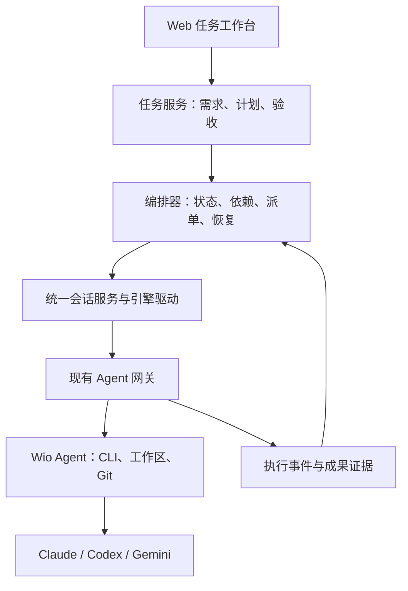

# P7 任务编排与团队协作

返回[路线图总览](README.md)。状态以总览的“进度总表”为准，本文件写设计边界、步骤和执行记录。

方向确认：2026-11-14，决策 D10、D11。Wio 继续作为主体，参考 OpenTeams 的设计，在现有 Go 控制面和 React 前端内补齐任务层。本阶段是新增产品能力，不属于保持行为不变的重构。

本阶段补充盘点基线为 Wio 提交 `65b5753`，版本 0.3.12；P0 至 P6 的历史基线仍以总览为准。下面的类型、模块和接口均为待实现设计，最终契约由 P7-01 固化，不能作为当前功能说明。

P7-01 的当前实现盘点更新到 `2260a01`（0.3.39 / schema 6，2026-11-18）。P2、P4、P6 已完成，已移除的会话隔离功能不作为任务依赖；下文“P7-01 冻结契约”取代旧基线中的接口草图。冻结表示后续实现遵循该设计，不表示产品能力已开放。

## 目标与交付顺序

目标流程：用户创建需求；协调成员拆解计划；开发和研究成员并行执行；开发完成后请求审查；审查不通过则有限返工；协调成员汇总，用户最终验收。Claude、Codex、Gemini 均可承担任一角色，角色不与引擎绑定。

按三批交付，每批都能独立使用：

| 里程碑 | 步骤 | 用户得到什么 |
| --- | --- | --- |
| M8 任务闭环 | P7-00 至 P7-04 | 创建任务、记录验收条件，执行明确的依赖计划，看到步骤状态、阻塞原因和关联会话 |
| M9 成果与审查 | P7-05、P7-06 | 审查指定版本的成果，返工后重新验证，最终由用户接受或拒绝 |
| M10 动态协作 | P7-07 至 P7-09 | 成员能请求审查、补充步骤或调整计划，平台校验后调度；可查看和编辑任务图 |

首批使用表单和步骤列表录入、确认计划，不要求模型自动生成计划或提供图形编辑器。跨服务器执行复用现有 Agent；跨服务器的代码和文件交接到 P7-05 才交付，首批只安排具备明确输入的步骤，不假设目录共享。

## 当前基础与缺口

已有基础见[会话协作协议](../SESSION_COLLABORATION.md)：

- 三种引擎的正式会话、跨引擎创建/交接、消息发送、追加指令、中断和按执行操作读取结果。
- 稳定请求编号与重试对账、持久化的 worktree 准备、排队和自动续聊。
- 来源身份绑定、授权范围、跨引擎权限映射、委派深度、活动子会话限制和等待环检测。
- 工作区、Git Worktree、执行事件、页面通知及原生会话链接。

这些能力尚未表达任务的验收条件、计划依赖、成果版本、审查结论和任务整体完成状态。会话空闲、操作成功或模型文本声称完成，都不能代替任务验收。现有等待环检测也不能限制成员不断要求对方返工的业务循环。

## 参考 OpenTeams 的范围

参考仓库：[openteams-lab/openteams](https://github.com/openteams-lab/openteams)，固定设计参考提交 [`59048236b6fd4a3760ec8a2991909d23ee78cc97`](https://github.com/openteams-lab/openteams/tree/59048236b6fd4a3760ec8a2991909d23ee78cc97)。本次依据源码和文档静态评估，未对上游做真实模型端到端验收。

| 参考内容 | Wio 的落点 |
| --- | --- |
| 计划与版本、编译后的步骤和依赖 | 任务计划版本、计划校验和就绪步骤计算 |
| 集中的状态迁移、事件和运行投影 | 控制面的任务状态机、条件更新、事务事件和页面读模型 |
| 团队成员、结构化消息和共享记录 | 任务内的角色、协作请求与可追溯上下文 |
| 成果、审查、修复循环和用户验收 | 版本化成果、绑定版本的审查与有限返工 |
| 工作流图和运行记录界面 | Wio 的任务工作台，复用现有会话外壳和深链 |

参考入口：[编译器](https://github.com/openteams-lab/openteams/blob/59048236b6fd4a3760ec8a2991909d23ee78cc97/crates/services/src/services/workflow/compiler/compiler.rs)、[编排器与 reducer](https://github.com/openteams-lab/openteams/tree/59048236b6fd4a3760ec8a2991909d23ee78cc97/crates/services/src/services/workflow/orchestrator)、[结构化协作消息](https://github.com/openteams-lab/openteams/blob/59048236b6fd4a3760ec8a2991909d23ee78cc97/crates/services/src/services/chat_runner/protocol.rs)、[worktree 状态机](https://github.com/openteams-lab/openteams/blob/59048236b6fd4a3760ec8a2991909d23ee78cc97/crates/services/src/services/session_worktree.rs)。

上游自由聊天的成员直发与工作流的统一调度有不同边界；消息租约和崩溃恢复增强在其[实施计划](https://github.com/openteams-lab/openteams/blob/59048236b6fd4a3760ec8a2991909d23ee78cc97/docs/chat-delivery-runtime-outbox-implementation-plan.md)中仍有待实现项。Wio 必须独立定义权限和恢复契约，不把参考实现视为已经验证的分布式调度保证。

本方向只参考设计，不复制上游源码、技能、素材、数据库迁移，也不引入其 Rust 服务、桌面壳或本地执行器。如后续决定复用具体代码，另行记录来源、许可证和改动范围。

## 设计边界

### 模块与职责

建议新增 `internal/task` 放领域类型与纯校验，`internal/taskservice` 放状态迁移和调度；`internal/store` 负责数据访问和事务。接口、包名以 P7-01 的依赖设计为准。三种引擎的差异继续由 P2 的驱动和能力对象处理，任务服务不复制适配器或在控制机直接启动远程工作区的 CLI。

现有 `internal/scheduler` 执行定时任务；任务编排器按依赖和事件推进。两者通过会话服务复用执行入口，不以定时任务表表达任务 DAG。

### 核心对象

| 对象 | 职责与关联 |
| --- | --- |
| Task | 项目内的需求、验收条件、预算、当前计划和最终验收记录 |
| PlanRevision | 不可变的计划快照，保存步骤、依赖、作者、依据和变更理由 |
| TaskRun | 一次计划执行，绑定计划版本；保存暂停、失败、取消和用户验收结果 |
| TaskMember | 任务内角色、引擎与执行设置、允许的工作区和会话引用 |
| Step | 一个开发、研究、审查或汇总工作单元，保存输入、输出、依赖与执行状态 |
| Attempt | 步骤的一次尝试，绑定会话引用、实际操作 ID、幂等键、调度所有权和结果游标 |
| ArtifactRevision | 不可变的成果清单，关联尝试、代码基线、commit/patch/文件摘要和验证证据 |
| Review | 对指定成果版本和验收条件的审查记录，保留意见和通过/拒绝结论 |
| CollaborationRequest | 成员请求审查、补充信息或改计划的结构化记录及处理结果 |
| TaskEvent | 与业务状态在事务中写入的事件，用于审计、恢复和前端投影 |

一个任务可以有多个成员、多个会话和多次执行；成员可以更换会话，但历史尝试必须保留原来的（引擎，会话 ID，操作 ID）。普通会话仍可独立使用。任务数据不能依赖未来是否将三张线程表物理合并。

### 状态与派单不变量

1. 业务状态只通过任务服务的集中迁移入口修改，校验预期旧状态/版本，状态和事件原子提交。WebSocket 负责加速刷新，数据库记录是事实来源。
2. 每个计划版本的依赖图必须无环，引用的成员、步骤、成果和工作区必须有效。修复循环通过新尝试或新执行轮次表达，不在 DAG 中随意添加回边。
3. 分别记录执行结束、成果提交、审查通过和用户验收。步骤成功不直接使任务通过最终验收；失败、未知或被跳过的必需步骤不能算作满足验收条件。
4. 就绪计算、资源占用和派单使用事务/条件更新。并发调度器只能领取同一次尝试一次，忙碌会话和工作区锁仍由现有入队规则约束。
5. 从（执行 ID、步骤 ID、尝试序号）生成稳定派单标识。尝试预留、入队和操作关联应在同一数据库事务里完成；无法共用事务的边界使用持久化待发送记录与幂等对账，不能留下“已发给 Agent、控制面却不知道”的无记录窗口。任务调度走显式的用户/任务授权入口，不冒用模型的来源身份。
6. 超时、断线或派单响应丢失时查询原请求与操作。调度租约过期不证明远端 CLI 已停止，不因此自动重发有副作用的步骤；无法确认的尝试保持未知/待处理，沿用引擎的停止确认边界。
7. 调度所有权、续租和结果写入匹配尝试编号及令牌/版本，旧调度者和旧尝试的迟到回执不得覆盖新尝试。租约用于控制面协调，不承诺文件或外部副作用恰好执行一次。
8. 每个工作流步骤只有一个调度负责人。编排器管理的轮次不再由父会话自动续聊或成员自行创建子任务来重复推进；独立会话协作继续使用原有流程。
9. 暂停停止派发新步骤，已在运行的尝试保留真实状态。取消应先阻止新派单，再请求中断已关联的操作，并显示未确认停止的状态；不自动回退文件或删除 worktree。
10. 自动重试、审查返工、计划修订、消息触发链和并发分别有上限，计数持久化；控制面重启不重置预算。具体默认值由 P7-01 固化并在执行前展示，不能通过重试绕过现有协作授权和限制。

### 角色、权限与动态协作

模型提出计划或请求，控制面校验并执行。任务成员身份由当前会话、轮次和任务绑定，不能仅凭模型输出中的角色名或目标 ID 取得权限。

任务范围授权明确项目、成员、工作区、引擎权限映射和预算。A 创建 B、C 不会自动给予 B 管理 C 的权限，也不要求用户开启“全项目会话管理”才能完成任务。P7-07 的协作请求路由以任务内的精确授权执行；不得隐式扩大现有协作工具的授权范围、层级或操作能力。

动态改计划形成新版本，校验依赖、资源和预算，记录哪些既有结果仍有效、哪些步骤需要重新执行。新增工作区、提高执行权限、增加预算或超出原需求的请求进入待用户处理状态；已有授权范围内的例行派单和返工不反复请求同一种授权。冻结的计划和历史结果不原地改写。

共享记录保存来源、版本和可见范围；文件、网页、模型结论和其他成员消息均作为任务材料。材料里写的指令不形成新授权。

### 成果、审查与代码交接

- 代码成果记录仓库身份、基线 SHA、成果 SHA 或 patch 摘要、来源工作区、产生尝试以及测试证据。尚未提交的修改以可核验的快照/patch 交接，不因捕获成果而自行提交。
- 新 worktree 基于 Git 引用，不会自动获得另一个工作区尚未提交的改动。审查者应读取不可变成果，或在准备好的审查工作区复现它，而非读取持续变化的开发目录。
- 跨服务器交接校验仓库和基线，安全传输显式清单中的文件/patch；处理权限、路径、大小和完整性校验，不能假设目录共享或把整个运行目录与凭据打包。
- 审查记录绑定成果版本与验收条件版本。返工产生新成果后，旧审查留作历史，不能自动视为新成果已通过；内容变化使相关下游验证失效。
- 测试命令、退出状态和实际输出属于证据；模型自报通过与平台取得的执行证据分别标注。用户能查看未运行或无法复核的检查。
- 代码整合单独预检目标分支、基线漂移和冲突，失败时保留现场。任务验收不自动授权提交、推送、部署或删除工作区；这些操作仍按用户既有授权执行。
- Worktree 只隔离 Git 工作目录。审查通过明确的成果交接完成；未合入或有冲突的工作区不得自动清理。

### 界面与兼容

任务工作台展示需求、验收条件、步骤、角色、依赖、当前尝试、成果、待处理事项及原生会话链接。首批使用步骤列表；图形编辑到 P7-08。角色可选任一受支持引擎，目标 Agent/CLI 不支持时显示具体原因。

任务界面复用 P2 的会话外壳，通过 P6 的规范地址打开会话；旧深链仍按 P6 兼容。任务对象不会替代普通会话和 P6 已确认的导航行为。新任务入口的具体位置、页面字段和 API 在 P7-01 中设计，后续步骤在该设计基础上实现。

新任务接口和事件单独定义命名空间，既有会话、操作和事件的持久化取值保持不变。新增表走 P1 迁移；新增 Agent 工具或操作走 P4 能力协商和载荷夹具，并按仓库规则升级 Agent 版本。旧 Agent 上无法保证的成果捕获/工具能力明确禁用，不静默跳过。

## P7-01 冻结契约

本节是后续实现的验收依据。新增包、方法、表、HTTP 路由和能力名均是设计；“现有”表格中的符号才是 `2260a01` 已有实现。若实现中发现无法满足契约，先修订本节和相关验收项，再写代码。

### 1. 当前代码、复用点与必须补齐的入口

下列路径均相对仓库根目录，可通过符号名定位，不依赖历史行号。

| 现有文件与符号 | 可以复用 | 任务层必须补齐 |
| --- | --- | --- |
| `internal/session/session.go`：`Ref`；`record.go`：`Record`；`driver.go`：`Driver` | 引擎与 Wio 会话 ID、统一读模型、事件读取、定时任务驱动 | `Driver` 没有通用 Create/Send 事务接口；不能拿 `EnqueueScheduled` 表达任务尝试 |
| `internal/sessionservice/service.go`：`Service.Execute`、`List`；`availability.go`：`WorkspaceEngines`、`ResolveEngineAvailability` | 正式协作工具入口、列表、工作区引擎可用性及原因 | `Execute` 要求实际模型来源，不能伪造 source 调用它完成用户授权的任务派单 |
| `internal/store/session_driver_collaboration.go`：`collaborationEngineDriver`、`createCollaborationSessionTx`、`collaborationSend`；三个 `session_driver_<engine>.go` | 已有事务内 Create/Send/Interrupt、权限设置及引擎差异 | 新增用户/任务身份的窄入口，在同一 `sqlx.Tx` 使用这些原生适配；不复制三套轮次实现 |
| `internal/store/session_collaboration_port.go`：`transactionPort`；`internal/sessionservice/core/mutate.go`：`Port`、`Mutate` | 调用者持有事务、端口不提交的约定 | 协作端口绑定来源、委派和子会话授权，不能直接当任务权限入口 |
| `internal/store/codex_requests.go`：`QueueCodexTurnRequest`；`session_collaboration_actions.go`：`queueCollaborationOperation` | 原子轮次/消息及既有请求去重模式 | 后者的 `session-tool:` 随机操作键不是稳定任务键；任务尝试关联和稳定键须在同一事务落库 |
| `internal/store/operations.go`：`PendingOperations`、`MarkDelivered`、`CompleteOperationIfActive`；`operation_completion.go`：`completeActiveOperation` | 持久化操作、原 ID 重送、终态条件更新 | 任务结果投影和原生轮次终态关联；操作终态本身不足以证明任务成功 |
| `internal/store/session_collaboration_result.go`：`collaborationTurnState`、`session_collaboration.go`：`collaborationTurnBounds`；`internal/agentgateway/operation_results.go`：`reconcileCompletedTurn`、`reconcileOperation` | 指定操作的结果边界、Codex 接受与结束分离、丢失结果对账 | 任务读取必须要求绑定操作的终止证据；保留未知来源，不能把合成的 failed 当成可安全重试的失败 |
| `internal/store/session_collaboration.go`：`ExecuteCollaboration`、`collaborationGrant`；`session_collaboration_actions.go`：`collaborationLimits`；`session_collaboration_worker.go`：`continueCollaboration` | 稳定 request_id、授权版本复核、深度/子会话限制、自动续聊 | 全局设置现在可以覆盖逐会话 grant；任务专属会话必须先执行编排所有权限制，不能靠写一个空 grant 防止重复调度 |
| `internal/store/session_collaboration_actions.go`：`workspaceWriteBusy`；三个原生入队器 | server → workspace 的锁顺序、既有工作区写入规则 | 同一任务成员/会话互斥；现有规则允许 Claude/Gemini 轮次共享目录，不能宣称已互斥全部模型写入 |
| `internal/store/tx_retry.go`：`inTx`、`inSerializableTx`、`nextEventSequence`；`events.go`：`AddEvent` | 有界事务重试、事件流序号分配 | 状态与任务事件同事务；重试回调内不得 Wake、发布 WebSocket 或访问 Agent |
| `internal/store/workspace_lifecycle.go`：`WorkspaceDeletionPlan`、`clearWorkspaceSessionRecords`；`project_deletion.go`：`ProjectDeletionPlan`；`retention.go`：`PruneRetainedData` | 删除预检和保留策略的接入位置 | 当前删除会清会话事件，保留查询不认识任务成果；必须加入任务证据保护再开放关联 |
| `internal/gitworktree/worktree.go`：`Create`；`internal/store/workspace_lifecycle.go`：`QueueCrossServerWorkspaceClone` | 原有 worktree 创建和跨机仓库克隆通道 | 仓库克隆不含未提交修改；不可变成果捕获、传输和审查工作区仍是 P7-05 新能力 |
| `internal/agentgateway/session_collaboration.go`：`receiveSessionTool`、`RunSessionCollaboration`；`internal/sessiontools/tools.go`：`Call`、`Grant`、`Definitions` | 实际 server/session/operation 身份、MCP 返回通道与工具定义 | P7-07 添加独立任务工具及鉴权；不以工具参数中的角色或 task_id 确立身份 |
| `web/src/navigation.ts`：`readLocationState`、`locationFor`；`web/src/data/requests.ts`；`web/src/realtime/scopes.ts` | 统一会话地址、公共取数层和范围失效 | 增加 tasks 路由、取数和 scope；不在新页面增加独立 WebSocket/轮询体系 |

### 2. 模块及事务端口

`internal/task` 保存领域 DTO、状态常量、规范化和纯校验，允许依赖 `session.Ref`，不依赖 Store、HTTP、网关或 CLI。`internal/taskservice` 保存命令处理、就绪计算与后台对账，定义它消费的 Repository 接口；Store 实现该接口。`cmd/controlplane` 装配任务服务、Store 和提交后的 `gateway.Wake`/实时通知。HTTP 只负责已认证用户身份、CSRF、输入限额和结果映射。

Repository 的最小方法为 `CreateTask`、`UpdateTask`、`AppendPlan`、`SetGrant`、`CreateRun`、`TransitionRun`、`DispatchAttempt`、`RecordAttemptEvidence`、`ResolveAttempt`、`RecordAcceptance`、`ArchiveTask`、`GetTask`、`ListTasks`、`ReadEvents`、`GetRequest`。每个修改方法接收 `CommandMeta{actor, request_id, expected_version}`，执行领域决定后以条件更新和事件原子提交。后台写入另带 `AttemptFence{attempt_id, lease_generation}`；领域决定在事务内依据重新读取的事实校验，不能只依赖事务外快照。

新增 `Store.DispatchTaskAttempt` 作为 `DispatchAttempt` 的实现：在自己的事务里校验任务授权、run/step 版本、预算和资源，预留尝试、创建/读取任务会话、调用原生驱动 Send、关联真实操作并写入事件。任务服务不拿到裸 `*sqlx.Tx`，也不调用自开事务的 HTTP/公开入队方法。新增 Store 内部 `taskSessionPort` 仅提供事务内 Create/Send/Interrupt/Observe，适配现有原生方法。取消使用同样的事务端口，为各活动尝试持久化中断意图和中断操作关联。

任务事件与会话事件都使用现有序号规则，锁顺序固定为 server（按 ID 排序）→ task/run → workspace（按 ID 排序）→ 会话/attempt → event stream（按 stream ID 排序）。跨层入口都按该顺序锁定并重读条件；纯任务编辑从 task 开始，不在持有 task 后补取 server。多服务器派单每事务只处理一个目标，避免锁住整张 DAG。P7-03 必须以 PostgreSQL 竞争用例验证与浏览器、协作、定时任务入口无锁顺序倒置。

P7-02 的用户草稿/计划命令先锁项目行作为 request_id 账本的串行入口，再锁任务与排序后的工作区；该路径不取 server 锁，也不派执行命令。后台调度不获取这个项目锁，仍使用上述 server → task 顺序。

### 3. 对象与字段

公共约定：ID 为服务生成的不透明字符串，时间为 UTC RFC3339；`version` 是从 1 开始的乐观并发号。模型不能指定数据库主键、actor、租约代次或实际操作 ID。输入字符串不作 shell 拼接；执行设置只接受引擎已有合法值。

| 对象 | 必需字段与约束 |
| --- | --- |
| Task | `id, project_id, title, requirement, criteria[], spec_version, current_plan_id?, current_run_id?, current_grant_revision?, counters, version, created_by, created_at, updated_at, archived_at?`；每条 criterion 有稳定 ID 和文本；需求/条件只能在无活动运行时修改，旧版本保存在 plan 快照中 |
| PlanRevision | `id, task_id, revision, parent_id?, spec_version, requirement_snapshot, criteria_snapshot, members[], steps[], grant_revision?, reason, author, content_hash, created_at`；不可变，引用同任务父版本；保存规范化 JSON 及 SHA256，revision 按任务递增；grant_revision 只记录设计依据，可为空，实际执行授权由 run 固化 |
| TaskMember（计划快照） | `id, role, engine, workspace_id, model, mode, effort, directory_mode`；role 为 `coordinator/developer/researcher/reviewer`，任何角色可选三种引擎；一个成员绑定一个工作区，换引擎/工作区必须新计划；M8 的 directory_mode 仅为 `shared/existing_worktree`，后者也必须已就绪 |
| Step（计划定义） | `id, member_id, kind, title, instructions, input_refs[], depends_on[], criterion_ids[], required, completion_policy`；kind 为 `plan/develop/research/review/summarize`；M8 所有步骤 required=true、策略为 `execution`，M9 增加 `artifact/review`；不得把未交付策略静默降级 |
| TaskRun | `id, task_id, plan_id, grant_revision, state, version, counters, started_at?, deadline_at?, ended_at?, accepted_by?, acceptance_reason?, accepted_at?`；每任务最多一个非终态 run，始终绑定不可变计划和需求/条件版本 |
| StepRun | `run_id, step_id, state, current_attempt_id?, block_code?, version`；每次 run 独立投影，不修改计划中的 Step；依赖只读取本 run、本 plan 的有效结果 |
| Attempt | `id, run_id, step_id, number, dispatch_key, input_hash, state, session_ref, server_id, workspace_id, operation_id?, interrupt_operation_id?, lease_owner?, lease_generation, lease_expires_at?, evidence_cursor, outcome_certainty, result_summary?, created_at, ended_at?`；保留实际执行设置和输入快照，不跟随成员后续设置变化 |
| TaskGrantRevision | `task_id, revision, actor, allowed_members, workspace_ids, execution_modes, budgets, enabled, created_at`；用户授权的不可变快照，任务保存当前 revision；收窄或撤销立即阻止新派单，历史授权仍可审计 |
| TaskEvent | `event_id, task_id, sequence, kind, schema_version, run_id?, step_id?, attempt_id?, actor, request_id?, payload, occurred_at`；与状态同事务，sequence 按任务单调递增 |
| TaskRequest | `actor_key, project_id, request_id, action, input_hash, task_id, response_json, created_at`；请求与状态同事务，成功后永久可对账；同键异参冲突，不重复执行 |

P7-05/06/07 逐批新增：`ArtifactRevision{id, task_id, run_id, attempt_id, revision, manifest_hash, repository_identity, base_sha?, result_sha?, patch_hash?, files[], evidence[], created_at}`；`Review{id, task_id, attempt_id, artifact_ids[], criteria_hash, verdict, evidence[], reason, created_at}`，verdict 为 `approved/rejected/inconclusive`；`CollaborationRequest{id, task_id, source_attempt_id, request_id, kind, target_member_id?, payload_hash, state, resolution, created_at}`。首批不创建空实现或可调用的占位工具。

计划校验执行 Kahn 拓扑排序：ID 不重复、依赖存在且无自依赖/环、成员和 criterion 均属于快照、工作区属于任务项目、输入引用必须来自依赖祖先或明确外部材料。保存计划不授予执行权限，P7-02 无 grant 时只校验项目与结构；启动和派单还要求全部引用在当前授权内。首批依赖只有 AND 汇合；不支持任意脚本条件、可选步骤、自动跳过必需步骤或回边。跨工作区的隐含文件交接在 M8 被拒绝；显式文本输入可跨服务器，代码交接到 P7-05 才可选择。

P7-02 实施细化：criterion/member/step 的 ID 是计划内逻辑键（1–64 个字母、数字、下划线或短横线），不由客户端指定任务、计划、run 或操作的数据库主键。`input_refs` 首批为 `{kind:"text",text}` 或 `{kind:"step_result",step_id}`，后者必须是祖先；普通会话材料先由用户显式录入为文本，原生会话直接取材和文件交接不作为隐含输入。没有活动授权时计划按默认规模校验，执行授权仍在 P7-03 独立确认。

### 4. 状态迁移与证据

Task 的显示状态由当前 run 投影：无 run 为 `draft`；run 的 running/paused/blocked/cancelling 为 `active`；其他直接显示 run 状态。`archived_at` 独立于执行状态，归档不代表通过。创建计划不触发执行；用户确认计划、授权和预算后 `CreateRun` 原子创建 run 和全部 StepRun 并进入 running。P7-02 只开放草稿/计划 API，直到 P7-03 验收通过才注册启动动作。

下表未列出的迁移一律拒绝。所有迁移都要求正确的 expected_version、任务/项目范围；状态、计数和 TaskEvent 同事务。运行中的结果归并还校验 attempt、operation 和 fence。证据原始落库不因 fence 失效而丢弃，旧调度者不得写当前投影。

| TaskRun 迁移 | 允许条件、证据与动作 | 拒绝条件 |
| --- | --- | --- |
| 无 → running | 用户选择 plan_id、当前授权；计划校验通过，无其他活动 run，预算足够；固化 plan/grant 和期限 | 空条件、环、越权、过期版本或未交付策略 |
| running/blocked → paused | 用户暂停；提交后所有 DispatchAttempt 检查失败；在途尝试继续归并 | 已终态或 cancelling |
| paused → running/blocked | 用户恢复，重新校验授权；有可推进步骤为 running，否则 blocked | 授权已撤销，或所有必需步骤已满足时应进入 awaiting_acceptance |
| running → blocked；blocked → running | 无活动尝试且剩余步骤全部等待资源/用户/失败处理时 blocked；阻塞解除且未暂停后自动恢复 | 不允许用 blocked 释放未知尝试占用；其他独立步骤可执行时保持 running 并列出局部阻塞 |
| running/paused/blocked → cancelling | 用户取消、撤销授权或运行期限到达；先关闭派单门，再逐尝试请求停止；保留取消原因 | 不能先显示 cancelled 再异步猜测停止 |
| cancelling → cancelled | 全部尝试未派出或有可信停止/终止证据；未启动步骤记 cancelled | 任一 running、unknown 或停止请求未确认 |
| awaiting_acceptance → cancelled | 用户取消并保存理由；此时已无活动尝试 | 不能覆盖已经 accepted/rejected 的决定 |
| running/paused/blocked → awaiting_acceptance | 全部必需 StepRun succeeded、无活动/未知尝试；M9 还要求成果和绑定版本审查通过 | 仅会话 idle、启动操作成功、模型声明完成或旧成果审查 |
| running/paused/blocked → failed | 必需步骤确定失败且无法在预算内继续，全部在途已终止；保存失败原因 | 无法确认远端结束；此时保留 blocked/paused，显示 unknown |
| awaiting_acceptance → accepted/rejected | 已认证用户提交决定、理由、当前 run/plan 和证据摘要；事务内复核版本和无未决必要证据 | 模型、调度器或 CLI 审批不能代替用户；拒绝不隐式执行返工 |
| accepted/rejected/failed/cancelled → 新 run | 用户重新打开；旧 run 不变，新 run ID、重新校验计划与授权，任务累计预算不清零 | 仍有活动/未知尝试；M8 不复用旧步骤成功结果 |

非终态 run 包括 running、paused、blocked、cancelling 和 awaiting_acceptance；accepted、rejected、failed、cancelled 才是终态。暂停与最后一个结果到达并发时，完整达成条件优先投影到 awaiting_acceptance，仍不派新步骤；否则保留 paused。取消提交后即使迟到成功也只保存该尝试的真实结果，run 最终仍为 cancelled，不转 awaiting_acceptance。取消与验收竞争由版本条件更新保证只有一个命令生效。

| StepRun / Attempt 迁移 | 条件与证据 |
| --- | --- |
| step pending → ready | 所有依赖 succeeded 且结果版本有效；无依赖可直接 ready。ready 是可重建投影，不能凭它跳过事务复核 |
| ready → blocked → ready | 会话忙、Agent 离线、工作区冲突、缺能力/凭据、预算或授权问题；保存具体 block_code；等待不分配新尝试号 |
| ready → active；attempt 无 → queued | 单事务领取、消耗一次尝试额度、保存输入、会话/操作关联与事件；没有已提交的“预留成功、操作缺失”中间状态 |
| queued → running | 已绑定操作的启动/原生接受证据；delivered 只说明派送，不能证明完成 |
| queued/running → succeeded | 平台取得该轮次的可信正常结束证据；M8 仅表明执行结束，StepRun 按 completion_policy 决定是否 succeeded，不表示验收条件已验证 |
| queued/running → failed/cancelled | 确认未执行就拒绝，或绑定轮次的失败/停止证据；已取消的未送操作必须以条件更新获胜，不能与派送竞争后声称未执行 |
| queued/running → unknown | Agent 丢失操作、原生所有权丢失、证据不足或超时且无法证实终止；step blocked，保留会话占用与业务阻塞，不自动重试 |
| unknown → running/succeeded/failed/cancelled | 当前对账者读取原 operation/原生轮次的可信证据，或用户提交可审计的停止核实记录；模型文本或 lease 过期不构成证据 |
| failed/cancelled → 新 attempt | 用户明确重试，或已启用的自动重试规则匹配安全失败，且旧尝试确认终止、授权和预算仍有效；旧 attempt 不变 |
| succeeded → 等待成果/审查或 step succeeded | `execution` 直接记录执行成功；`artifact` 要求不可变清单；`review` 要求指定成果/criteria_hash 的合格审查；缺失保持 step blocked |
| step succeeded → ready/pending（M9） | 指定成果的真实 rejected 审查触发一次授权内返工：生产步骤 ready，受影响的下游 pending；只允许相关尝试全部可信终止且预算足够时原子失效，保存旧结果来源和失效事件 |

Codex 必须按 `operation_id` 对应的 turn 接受事件、turn ID/消息区间与终止事件关联；不能复用 `collaborationTurnState` 中“当前会话 idle 且 start succeeded”的兼容回退作为任务成功证据。Claude/Gemini 以绑定操作的真实终态及所有权恢复事实归并。`OperationLostMessage` 等网关合成失败明确映射到任务 unknown；P7-03 新增持久化的证据来源分类，不能仅匹配错误文案。历史证据按 `(attempt_id, source_event_id)` 去重，游标推进与投影原子提交。

StepRun 状态固定为 pending、ready、active、blocked、succeeded、failed、cancelled。attempt 失败/取消且可重试时 step 为 blocked，明确重试动作使其 ready；预算耗尽且旧尝试均已结束才置 failed。run 取消时未执行步骤置 cancelled，已成功步骤保持历史 succeeded。queued 在网关取出后、MarkDelivered 前仍可能已经发送，单凭操作行 queued/cancelled 不能证明未执行；P7-03 必须对这个窗口注入竞争，若没有可靠的未发送证明，继续中断/所有权对账并保留 cancelling/unknown。

重试、返工、动态改计划、重新打开都不清除旧记录。M9 在同 run 内通过新 Attempt 返工，不给 DAG 加回边：review 的 rejected/inconclusive 先使审查步骤 blocked，不满足依赖；rejected 可在已有授权/预算内把指定生产步骤重新置 ready、审查及其受影响后继置 pending，inconclusive 等用户补证据或明确重审。失效范围、旧 attempt/artifact/review ID、返工计数和事件同事务落库；有在途/未知后继时先暂停并确认停止，再失效，不能边执行边换输入。新尝试的 input_hash 绑定新的成果及依赖结果，旧审查不能再次归并为新步骤成功。M10 计划替换先暂停派单并处理在途尝试，形成新 plan/run；只能显式继承输入摘要、成果/条件版本均未变化的结果并记录来源，旧操作不满足新步骤。

### 5. 派单幂等、租约和恢复窗口

外部修改请求必须有 1–128 字符的 `request_id`，范围为 `(actor_key, project_id, request_id)`；输入摘要包含动作、目标、expected_version 和规范化业务输入，排除传输元数据。成功去重记录先于当前状态/版本错误返回检查，因此响应丢失后仍返回原成功结果；仍校验读取权限。异参返回 `IDEMPOTENCY_CONFLICT`。同一动作的新意图才使用新编号。校验失败/事务回滚未消耗编号，HTTP 响应丢失不能据此推断回滚。

尝试身份唯一 `(run_id, step_id, number)`，派单键为 `task:<run_id>:<step_id>:<number>`，全局唯一。操作可继续由原生队列生成 ID，但 `task_attempts.dispatch_key`、`operation_id` 唯一关联与操作插入同事务提交；有多阶段准备时每阶段使用该键的固定后缀并保存阶段操作，不能覆盖执行轮次 ID。M8 使用已就绪工作区和新建专属会话，不在派单时隐式创建 worktree。

| 故障窗口 | 持久化事实与恢复动作 |
| --- | --- |
| 校验/尝试领取前崩溃 | 没有已提交尝试和操作，重算 ready；原请求对账后才能重试 |
| 尝试、会话、队列、关联、事件任一写入失败 | 同一事务全部回滚；注入每个写入点确认无孤立会话、半份尝试和额度扣减 |
| COMMIT 响应丢失 | 查原 request_id 或 dispatch_key；找到则读取原操作，找不到且数据库查询可靠完成后才重进同键事务 |
| 提交后、Wake 或 WebSocket 前崩溃 | 操作仍在队列；后台扫描与现有 PendingOperations 投递原 ID，事件可补查 |
| 发送后、MarkDelivered 或响应前断线 | 原操作 ID 重送，由既有 Agent 回执/去重恢复；任务层不生成新操作来“补发” |
| Codex start 成功，轮次仍运行/终止事件丢失 | 继续原轮次对账；无终止证据为 running/unknown，不能使下游 ready |
| 原生结果落库后、任务归并前崩溃 | 以 attempt 的原操作和证据游标重新归并，事务去重，不重派 CLI |
| lease 到期，旧 worker 或旧轮次晚到 | 新 worker CAS 增加 lease_generation 后只观察原操作；旧 fence 更新为零行；原始回执保留，当前 worker 再归并 |
| 取消提交后、停止请求排队前崩溃 | run=cancelling 是持久化停止意图；后台逐尝试补入同键中断，未确认前保留占用 |
| Agent 重启并失去 CLI/操作所有权 | 沿用引擎现有探测，缺证据保持 unknown；用户核实停止后才可新尝试 |

租约默认 30 秒；当前 worker 每 2 秒轮询时续租（不晚于原定 10 秒），过期比较使用数据库当前时间，在事务内持有任务锁并按 owner/代次写入；新 owner 接手增加代次。lease 只保护控制面归并权，不替代原生执行所有权。所有有副作用的 CLI 都仍经原操作通道；任务服务没有提交事务之前向 Agent 发命令的路径。P7-05 跨机准备若不能放进同一事务，先写持久化阶段意图/outbox，再由现有操作队列以稳定阶段键执行，按阶段原操作对账。

### 6. 授权、占用与预算

用户通过任务启动确认授予“按这个计划在这些工作区用这些权限执行”的范围，服务保存实际用户 ID；后台 actor 为 `task:<task_id>`，记录所依据的 grant_revision，不冒用任何模型。开始、每次派单和返工前复核当前授权；撤销把活动 run 置 cancelling，保留停止未确认状态。扩大工作区、权限、预算必须用户形成新授权版本，不能继承模型输出中的同意。当前系统是单管理员，跨项目隔离仍必须通过 project_id 条件和所有引用的项目一致性校验实现。

M8 每个成员每个 run 创建新的专属会话；普通已有会话只可作明确输入链接，暂不接管其历史权限或自动续聊。新增 `task_session_bindings` 以 `(engine, session_id)` 唯一保存 active attempt/run。事务内检查覆盖所有可开新轮次/转向/原生分叉/归档/删除入口：浏览器、定时任务、协作工具、自动续聊均不能修改仍由任务占用的会话。全局协作 grant 也不能绕过；只读和原生审批/用户提问回答仍可用，回答不派新轮次。任务成员 M8 禁止自行派子会话或对其他会话发指令；动态请求统一到 P7-07。

绑定在整个活动 run 内保留，`active_attempt_id` 可在步骤间为空；执行并发额度只统计 queued/running/unknown 的实际尝试，unknown 也占额度。尝试确认结束才释放执行与工作区占用，run 终态或完成接管才解除会话编排绑定；不能在两步骤之间暂时放开普通入口。

独立会话协作现有深度 2、每来源 2 个活动子会话及续聊额度保持生效；任务成员不是其隐式子会话，不创建 `session_links` 规避额度。任务使用自己公开的并发上限并只允许编排器推进；禁止工具旁路与禁止父自动续聊必须同时验收。用户手动接管先暂停整个 run，要求原尝试可信终止，将会话绑定解除并保留证据；之后手动轮次不能满足任务依赖。恢复该步骤用新的专属会话和新尝试，unknown 未解除时拒绝接管/重跑。

现有工作区并发行为保持不变：Claude/Gemini 的轮次可共享目录，其他写操作遵循既有互斥；Codex 也可并行。任务为同工作区的成员默认增加串行占用（覆盖三种引擎），不同工作区才按依赖并行。此占用约束任务派单，不能保证独立普通会话不改目录，页面明确共享目录可能被其他会话修改；P7-05 的审查依赖不可变成果。普通 Git/文件操作仍经过现有锁，不能用任务占用绕开它。

| 限额 | 默认 / 硬上限 | 持久化与处理 |
| --- | --- | --- |
| 计划规模 | 8 成员、50 步骤 / 16 成员、100 步骤 | 任务建立时展示，依赖边最多 1000；请求体最多 1 MiB，单步 instructions 最多 64 KiB |
| 并发 | 每任务 2 / 4；每成员/会话 1 | ready 派单事务检查，跨 worker 共用计数；同工作区默认 1 |
| 总尝试 | 每任务 100 / 500；每 run-step 3 / 5 | 初次执行、人工重试和返工均计入；自动重试默认 0，用户可开到 1；只针对已证实未执行的暂时拒绝，不针对执行中断/未知 |
| 审查返工 | 每步骤 2 / 4 | M9 开放；受每 run-step 尝试和任务总尝试同时约束，展示有效的较小上限 |
| 计划版本 / 执行次数 | 每任务 10 / 50；每任务 10 / 50 | 新计划/新 run 均不重置任务累计次数；达到上限等用户明确扩额 |
| 动态消息 | 每任务 100 / 1000；因果链深度 8 / 16 | M10 开放，重复请求不扣第二次，派生链计数跨重启保存 |
| 步骤 / run 时间 | 60 分钟 / 24 小时；上限 24 小时 / 7 天 | 派单固化 deadline；到期停止新派单并请求中断，未确认则 unknown/cancelling，不把超时当作进程已停止 |

硬上限以内提高预算仍需用户确认。M8 不声称提供金额/token 强制上限：现有三引擎用量不是可靠的预付费截断机制；页面显示可取得的真实用量及缺失值，不以估算阻止对账。标题最多 200 字符、需求最多 64 KiB、验收条件 1–50 条且每条最多 4 KiB；超限直接拒绝，不截断后执行。

### 7. 数据库、保留与版本兼容

P7-02 从 schema 6 追加 migration 7（`task_core`，实施时若序号已被使用则先更新本节），不修改已发布 migration 6，也不重建三种原生线程表。新增表为 `tasks`、`task_plan_revisions`、`task_plan_members`、`task_plan_steps`、`task_step_dependencies`、`task_grant_revisions`、`task_runs`、`task_step_runs`、`task_attempts`、`task_session_bindings`、`task_requests`。成员/步骤/依赖按 plan 快照存储，JSON 与规范化行在同一事务生成并验证摘要一致。

任务事件复用 `events`，stream_id 为 `task:<task_id>`，事件内容为上文 TaskEvent，`sequence`、event_id 和 occurred_at 使用外层既有字段；不再创建另一份事件事实表。`RecordAttemptEvidence` 在 P7-03 追加 `task_attempt_evidence`，保存来源事件 ID、原始摘要、证据分类与取得时间；P7-05/06/07 再追加成果、审查、协作请求和必要 outbox 表，迁移号在各步领取时确定。P7-02 先建立 task 事件再开放写 API。

必须由数据库约束保证：`(task_id,revision)` 计划/授权唯一、`(run_id,step_id,number)` 尝试唯一、dispatch_key 唯一、operation_id 非空时唯一、`(actor_key,project_id,request_id)` 请求唯一、`(task_id,sequence)` 由事件流保证唯一；每任务至多一个活动 run、每会话至多一个活动绑定使用两库均支持的部分唯一索引。父子对象通过复合外键/唯一键保证 task/plan/run 一致；非法跨项目引用仍在事务内校验。状态 CHECK 仅约束任务新表，不修改线上原操作状态。

SQLite/PostgreSQL 使用同一事务语义，SQL 参数走 `Store.Q`，时间/布尔遵循现有类型；JSON 为 TEXT 并在领域层验证，不能只用 PostgreSQL JSON 运算或内存互斥实现约束。PostgreSQL 事务重试回调不得执行事务外副作用；SQLite 沿用已有连接和已登记的取消问题边界，后台任务命令使用服务生命周期管理的有界事务 context，不直接继承已断开的 WebSocket/gRPC 流。两库迁移做 schema6 → 新版本、重复打开、约束冲突、原子回滚和原生会话数据摘要校验；新结构旧制品拒绝启动，回滚恢复备份，不因“只加表”声称旧版本可连新库。

任务及其证据不随项目/工作区/会话删除级联：tasks.project_id 和活动绑定使用 RESTRICT；历史 Attempt 保存来源 ID、路径/仓库身份快照，无指向原生线程的级联外键。归档保留深链；活动/未知关联阻止会话、worktree、工作区和项目删除，包括 force。M8 历史关联仍阻止破坏性删除，提供归档；P7-05 完成证据快照后才可按显式释放流程移除历史源工作区，深链显示来源已删除，不能丢证据。保留任务原操作、任务事件、引用的会话事件和成果文件，`PruneRetainedData` 显式排除全部任务引用，不能依赖当前 kind 恰好被保留。首批没有硬删除任务 API，只有终态归档/恢复。

`internal/store` 在 Agent 依赖树内的变更按 AGENTS 规则同时升 Agent 版本；本设计步骤无源码变更，不升级 0.3.39。M8 复用现有三引擎轮次能力，按 `WorkspaceEngines` 判断可用，不增加没有实现的通用 `task.run` 能力，也不抬高全局最低 Agent。M9/M10 分别增加版本化能力 `task.artifacts.v1`、`task.collaboration.v1`，在 P4 注册表、处理器和只增 wire fixtures 同步落地；新旧 Agent 混用时只禁用缺失能力的步骤，不静默跳过必要成果/审查。

### 8. HTTP、事件和基础工作台

以下为新增设计，全部位于现有鉴权/CSRF 私有路由下；接口 JSON 字段使用 snake_case，错误兼容现有 `error` 字符串并增加 `code`、`details`。越项目 ID 视为 404；未登录 401、无执行授权 403、非法字段/图 400、同键异参或版本/状态冲突 409、有效计划因尚不支持的策略而不能执行 422。运行中资源暂忙以持久化 block_code 返回，不用 HTTP 成功声称已启动 CLI。

P7-02 实施细化：除创建任务在 body 中提供 project_id，其余任务列表、详情、修改、计划、事件和请求对账路由均要求 query 的 `project_id`，Store 查询始终同时匹配该范围及任务 ID。当前单管理员仍可显式切换项目；不可把另一个项目的任务 ID 或资源混入当前项目请求。

| 路由 | 请求/返回与交付步骤 |
| --- | --- |
| `POST /api/tasks` | `{request_id, project_id, title, requirement, criteria}` → 201 `{task}`；只建草稿，P7-02 |
| `GET /api/tasks?project_id=&state=&cursor=&limit=` | `{items,next_cursor}`；limit 默认 50、最大 100，按 updated_at/id 稳定游标，P7-02 |
| `GET /api/tasks/{taskID}` | `{task,plan?,run?,steps,members,blockers,capabilities,last_sequence}` 一致性快照，P7-02；大证据分页读取 |
| `PATCH /api/tasks/{taskID}` | `{request_id,expected_version,title?,requirement?,criteria?}` → `{task}`；修改条件增加 spec_version 并使旧计划不可直接启动，P7-02 |
| `POST /api/tasks/{taskID}/plans` | `{request_id,expected_version,parent_id?,members,steps,reason}` → 201 `{plan,task_version}`；保存冻结快照，不派单，P7-02 |
| `PUT /api/tasks/{taskID}/grant` | `{request_id,expected_version,enabled,allowed_members,workspace_ids,execution_modes,budgets}` → `{grant,task_version}`；execution_modes 按成员 ID 记录引擎和权限模式，用户授权版本，P7-03 |
| `POST /api/tasks/{taskID}/runs` | `{request_id,expected_version,plan_id,grant_revision}` → 201 `{run,task_version}`；启动或终态后重新打开，P7-03 |
| `POST /api/tasks/{taskID}/runs/{runID}/actions` | `{request_id,expected_version,action,reason,...}`，action=`pause/resume/cancel/takeover/retry_step/resolve_unknown`；takeover 指定 attempt，retry 指定 step，resolve 指定证据，→ 202 `{run,request_id}`，P7-03 |
| `POST /api/tasks/{taskID}/runs/{runID}/acceptance` | `{request_id,expected_version,decision,reason,evidence_hash}`，decision=`accepted/rejected` → `{run}`；M8 基础用户决定，M9 增加成果/审查强校验，P7-04 |
| `POST /api/tasks/{taskID}/archive` | `{request_id,expected_version,archived}` → `{task}`；只允许无活动 run，P7-04 |
| `GET /api/tasks/{taskID}/events?after=&limit=` | `{items,next_after,has_more}`，after 为 sequence，默认 100、最大 500，P7-02 |
| `GET /api/task-requests/{requestID}?project_id=` | 当前用户的原命令 `{action,task_id,response}`；404 后仍以原编号重试，不能仅因短暂查不到换号，P7-02 |

expected_version 对 task 修改取 task.version，对 run 动作取 run.version；命令同时改变对象时响应返回两者。GET 快照的 last_sequence 与投影取同一数据库快照。成功去重返回第一次成功的响应与 HTTP 状态，后续状态变化由 GET 获取。`resolve_unknown` 的用户记录必须说明核实方法、停止时间和证据来源，不能让一个“标记成功”按钮凭空满足依赖。

无活动 run 时修改需求/条件会增加 spec_version、清除 current_run_id 并回到 draft；历史 run 与旧计划仍保留，不能把旧需求的 accepted 显示为新需求已验收。只修改标题不改变执行/验收记录。

事件命名固定为 `task.created`、`task.spec.updated`、`task.plan.created`、`task.grant.updated`、`task.run.created`、`task.run.state.changed`、`task.step.state.changed`、`task.attempt.queued`、`task.attempt.state.changed`、`task.attempt.evidence.recorded`、`task.acceptance.recorded`、`task.archived`；M9/M10 再追加 `task.artifact.created`、`task.review.recorded`、`task.request.updated`。新 payload `schema_version=1`，外层保持现有 StreamEvent。WebSocket 只作失效提示，事件未发布可从数据库补读；客户端遇到游标缺口或不认识的事件取完整快照，不从事件推测终态。

P7-07 的工具最小集合为 `wio_get_task_context`（只读）、`wio_request_task_review`、`wio_report_task_blocker`、`wio_propose_task_plan`（后三者持久化请求，不直接派 CLI 或改状态）。写入均带原 request_id；模型只提供目标成员/成果和理由。网关以已认证 server_id、实际 session_ref、operation_id 解析活动 Attempt，再确定 task/run/member/grant；任务 ID、角色和预算不接受模型自报。非任务会话、旧轮次和已经解除绑定的来源拒绝调用；同请求同摘要返回原处理结果，越范围进入待用户处理或明确拒绝。读取上下文只返回任务授权内的材料；新工具仅在 `task.collaboration.v1` 完整注册并实现后暴露。

P7-04 在“会话”旁新增“任务”，规范地址 `/?view=tasks&task=<id>`；项目页增加带 project_id 的创建/筛选入口，首页只新增任务概览，不改既有会话导航。任务页使用 `web/src/data` 和新增 tasks realtime scope，接入现有断线回退刷新；重连、页面重新可见或命令完成后重新读取快照。会话链接仍由 `locationFor("sessions", id, engine)` 生成 `/?view=sessions&engine=<engine>&thread=<id>`，旧引擎深链继续兼容。

创建页先录入需求/条件，再选择角色、引擎、已就绪工作区及执行设置，最后编辑步骤和依赖列表；确认页列出计划版本、权限、预算、共享目录提示和必需输入。M8 不显示尚未开放的模型自动规划、成果传输或图编辑入口。详情页显示需求/条件版本、步骤列表、依赖、成员、真实轮次链接、当前尝试、局部阻塞与待处理事项；执行成功显示“执行已结束，等待用户验收”，不显示“条件已验证”。暂停、取消、重试和停止未确认状态在手机列表上同样可操作；只有未知状态需要用户处理时才提供带证据的解除入口。

### 9. 可重复验收及后续拆分

下列测试名是后续必须实现的场景标识，不表示当前已有这些测试。固定临时数据库、假时钟、假引擎脚本和临时 Git 仓库，不调用真实模型；同场景在 SQLite 和 PostgreSQL 跑，竞争/租约测试在 PostgreSQL 使用两连接和明确屏障，不靠 sleep 证明竞态。

| 步骤 / 场景标识 | 夹具及故障注入 | 必须断言 |
| --- | --- | --- |
| P7-02 `TaskCoreMigration` / `TaskCommandAtomicity` | schema6 样本；在 task/plan/member/step/event/request 各写入点失败；同请求重复和异参 | 原生三引擎记录摘要不变、重复迁移一致；全有或全无；相同响应、异参冲突；跨项目/非法 DAG 拒绝 |
| P7-02 `TaskConcurrentVersion` / `TaskEvidenceRetention` | 双连接同版本更新；项目/工作区/会话删除预检与 force、retention | 一个更新胜出；活动与历史证据均不被清理；归档不变验收状态 |
| P7-03 `TaskDispatchCrashWindows` | 第 5 节每个窗口注入崩溃、COMMIT 未确认、Wake 丢失、重复回执 | 每个 dispatch_key 恰好一个已关联操作/消息；原 ID 对账；无孤立会话或重复额度 |
| P7-03 `TaskLeaseFence` / `TaskUnknownOwnership` | 两 worker 竞争；假时钟到期，旧 fence 写入、远端继续运行，迟到原回执 | 只当前 fence 投影，lease 到期不新建操作；unknown 保留占用，可信终止后才可重试 |
| P7-03 `TaskThreeEngineJoin` / `TaskCodexAcceptanceOnly` | P0-07 真实 HTTP/gRPC/Agent，加三种假引擎；A→B/C→汇总；Codex start 先成功但延迟终止 | 三引擎真实操作 ID 可查，依赖按本 run 汇合；B/C 不同工作区可并行，同成员/目录串行；start 成功不放行 |
| P7-03 `TaskPauseCancelRestart` | 派单事务与 pause/cancel 设屏障；控制面重启一次；Agent 断连 | 提交后不再新派单，取消保留未确认停止；重启继续原操作，无假 cancelled |
| P7-03 `TaskAuthorityAndTakeover` | 全局协作开启；浏览器、定时任务、模型工具、父续聊竞争；撤权与用户接管 | 无重复负责人/权限扩张；任务占用入口统一拦截；只读/审批可用；手动轮次不满足任务依赖 |
| P7-04 `TaskWorkbenchRecovery` | Playwright 桌面/手机三引擎步骤，漏 WS、刷新、重连、能力缺失、预算用尽 | 从快照恢复，可打开实际会话，不能把模型自报当验收；旧链接和普通会话不回归；类型、测试和 bundle 检查通过 |
| P7-05 `TaskImmutableHandoff` | 捕获未提交 patch 后继续修改；两 Agent 使用不同根目录；坏摘要/越界/错基线/缺能力 | 审查输入不可变，失败不污染目标；不自动提交或清理冲突 worktree |
| P7-06 `TaskReviewRework` / `TaskAcceptanceVersions` | 审查拒绝一次→新尝试/成果→再审查，预算边界前后重启；旧批准迟到 | 旧审查不能批准新成果，必要检查缺失不可通过；累计预算不重置，只有用户验收 |
| P7-07 `TaskRequestIdentityAndPlanRevision` | B 请求 C 审查并向 A 反馈；伪造 source/operation；重复消息、回边、扩大权限、新旧计划回执 | 精确任务授权、不用全项目管理；请求幂等且链路有界，新 plan 的失效关系可查 |
| P7-08/09 `TaskGraphAndRealBrowserFlow` | 图/列表同快照并发编辑；P0-08 浏览器接真实链路，完整一次拒绝返工 | 版本冲突可定位，历史可查，手机可操作，成果/轮次/验收证据一致 |

假引擎证明平台状态、路由、队列、故障恢复与界面，不证明官方 CLI 格式兼容或模型质量。真实 CLI 验收另记录三种 CLI 精确版本、原生恢复和工具能力；真实上游模型调用另记录授权、实际响应及费用，不能用假回复替代。生产升级另做备份/恢复演练与真实 Agent 心跳验收，不因本设计冻结而执行发布。

后续 L 步骤按可独立验收提交拆分：P7-02 先 schema/约束与 Store 命令，再 API/删除保留；P7-03 先事务派单与身份保护，再结果证据/租约恢复，最后三引擎故障矩阵；P7-05 先本地不可变清单，再审查工作区，再跨机传输；每批补齐对应通用、PostgreSQL、跨进程或页面验收后才能开放入口。P7-01 完成不跨级领取 P7-03，也不把尚未实现的协议能力列为当前功能。

P7-03 实施细化（2026-11-18）：追加 schema 8（`task_execution`），不修改 schema 7；补充成员绑定、尝试期限和证据表。原生引擎仍使用现有事务内入队器，提交前把操作的 idempotency_key 固化为 attempt 的 dispatch_key，重试先对账该尝试。Agent 原始回执与控制面合成的未知结果分别持久化分类，结果投影只接受当前租约代次；Codex 额外要求原操作的接受事件与对应 turn ID 的终止事件。取消直接持久化中断原操作的意图，不使用“queued 即未发送”的推断。执行 API 随本步验收接入私有路由，使用现有登录与 CSRF 校验；任务工作台仍由 P7-04 交付。

执行实现继续收紧证据边界：Codex 启动失败回执若没有原 turn 的终止证据，同样保持 unknown；原生启动 RPC 失败不能证明远端没有开始。M8 的自动重试暂固定为 0，不开放缺少“已证实未执行”分类依据的自动重试选项；用户仍可在已确认失败/停止及预算内重试。任务授权可收窄为计划的子集，之后的新派单会被阻止，恢复完整范围前不自动扩大授权。用户对 unknown 的解除只允许提交停止时间、核实依据及 failed/cancelled 结论，不能人工填成功；确认后解除旧会话绑定，后续步骤使用新专属会话。

## 步骤

前置、规模和状态以总览进度总表为准。实现时每个 L 步骤先拆成可独立验证的提交，不在一个提交里同时改存储、Agent 和界面。

### P7-00 方向确认与执行计划（纯文档）

**做法**

记录用户已确认的 D10、D11；建立本阶段文件、交付里程碑、步骤依赖和验收场景；同步 P2、P6 与现有功能文档，明确计划和已实现能力的区别。

**验收**

- 总览、阶段文件与产品文档对方向、范围和前置的描述一致。
- Markdown 链接、步骤编号和依赖检查通过，`git diff --check` 通过。
- 仅更新文档，不以本步骤完成标记任何产品实现已完成。

### P7-01 任务模型、状态与接口契约设计（纯文档）

**做法**

1. 按当前提交重新盘点统一会话服务、操作队列、协作授权、事件和 worktree，列出可以复用的真实符号、事务入口与缺口。P2 已完成；区分现有读/定时任务接口和仍需新增的任务派单入口，不将草图当作可调用实现。
2. 固化对象关系、字段、状态转移矩阵、幂等边界、租约/尝试身份和恢复策略；明确暂停、取消、未知执行、最终验收及重新打开任务的语义。
3. 设计任务授权和调度身份入口，明确与现有子会话额度、自动续聊和工作区锁的关系；确定各类预算默认值。
4. 给出 SQLite/PostgreSQL 迁移方案、会话关联和删除保留策略、HTTP/事件契约、基础工作台与任务入口设计，以及未来任务工具的能力声明方式。冻结前在本文件补充具体契约，不在正文中预先宣称已实现。
5. 将下方端到端场景拆成可重复的自动化验收用例，明确假引擎、真实 CLI 和真实上游调用分别证明什么。

**验收**

- 每条关键状态迁移有允许/拒绝条件、事务边界和证据要求。
- 可以追踪“一条派单从创建尝试到真实操作再到业务结果”的所有失败窗口；不存在靠换请求编号解决超时的路径。
- 具体模块、接口、预算与 UI 设计已补入本文，后续步骤能据此执行；按纯文档验收。

### P7-02 任务、计划、成员、步骤与尝试记录持久化

**做法**

按 P7-01 新增任务相关表、Store 查询、条件更新和事务事件。首批成员由用户指定角色、引擎与工作区；提供创建/读取任务和提交明确计划的 API。统一会话引用保持引擎无关，计划版本和历史尝试不可覆盖。删除或归档会话时保留任务证据所需的来源记录。

**验收**

- 两种数据库迁移和存储测试通过，旧会话可继续使用。
- 重复请求不重复创建任务/计划，并发状态更新只能有一个成功；事务失败不会只保存一半状态或事件。
- 非法依赖、越界工作区和无效成员被拒绝；跨项目任务数据不能互相读取或关联。

### P7-03 依赖调度、会话派单与恢复

**做法**

实现计划校验、就绪计算、并行汇合、尝试预留、原子/幂等派单、结果对账、暂停、取消及重启恢复。通过统一会话服务选择三种引擎，保存真实操作 ID；统一处理忙碌会话、Agent 离线和工作区写锁。独立实现任务业务状态，不用引擎原生的 `idle` 或启动操作成功代替任务完成。

**验收**

- “规划 → 开发与研究并行 → 汇总”按依赖推进；同一成员的冲突执行不会同时启动。
- 在尝试预留、入队、操作关联、回执到达等边界注入故障，重启/重试不生成重复轮次。
- 两个调度者竞争、租约交接、旧回执迟到、用户手动接管和来源授权撤销均有用例。
- 远端状态未知时不会重发写入任务或提前释放占用；暂停/取消后不再派新步骤。
- P0-07 的真实 HTTP/gRPC/Agent 加假引擎链路至少验证三种引擎派单和一次重启对账。

### P7-04 基础任务工作台与会话衔接

**做法**

按 P7-01 的界面设计实现任务创建、验收条件、明确计划录入/确认、成员选择、步骤列表、阻塞原因、暂停/取消与会话深链。状态由持久化读模型恢复，实时断线后能重新查询。首批不要求可视化编辑或动态改计划。

**验收**

- 桌面和移动端可看到同一任务下三种引擎的步骤，并打开实际会话。
- 页面刷新或 WebSocket 漏事件后，状态能与控制面重新一致；模型自报完成不显示为已验收。
- 普通会话和旧深链仍能使用；引擎能力不足、工作区不可用和预算用尽有明确提示。
- 前端测试、Playwright 和 bundle 检查通过。

P7-04 的任务深链携带已知 project_id。只包含 task ID 的链接通过私有定位 API 取得项目后再读取。详情和命令要求明确项目范围。首页读取跨项目的最近任务摘要。基础用户验收复用 schema 7 的运行字段，验收事件保存服务端从当前运行、步骤与尝试证据计算的摘要，提交时重新校验。

### P7-05 版本化成果与工作区交接

**做法**

分批实现成果清单/摘要与证据关联、同机审查工作区准备、跨服务器受控传输、应用前基线检查和整合预检。需要新增 Agent 能力时通过 P4 的协议与版本机制交付，不另建模型执行通道。

**验收**

- 能在不替用户提交的情况下捕获未提交修改，并在独立工作区复现指定版本。
- 过期基线、摘要不符、路径越界和缺失文件被拒绝，不污染目标工作区。
- 跨服务器交接不依赖相同路径；旧 Agent 不支持时明确拒绝相应能力。
- 开发继续产生新修改不会改变已保存的审查输入；冲突或未合入成果不会自动清理。

P7-05 的交接复用 Agent 操作队列。成果只保存用户逐个选定文件的改动，包含源尝试、Git 基线、每个文件在基线中的摘要以及改动后的内容和摘要。对目标的预检和复现在目标 Agent 执行，采用项目范围和 Git 基线共同校验仓库身份。复现目标可选同项目里已经创建的独立工作树，也可以是另一台 Agent 上已有的独立工作树。整合预检可选择主工作区。首批支持有大小上限的普通文件新增、修改和删除，复用 Git 的二进制补丁检查和应用，工作区保持未提交状态。

### P7-06 审查、有限返工与最终验收

**做法**

为指定成果版本派发审查，保存验收条件与证据，支持通过、拒绝、无法判断以及修复后的重新审查。返工生成新尝试和新成果，保留旧结论。达到预算或缺少证据时交给用户处理；协调成员汇总后由用户最终接受或拒绝。代码整合只有在已有相应授权时才执行。

**验收**

- 开发完成后审查拒绝一次，修复形成新成果，旧审查不能批准新成果。
- 失败、未知、未运行的必要验证不会自动成为通过；拒绝和无法判断均保留原因。
- 返工上限跨重启保持；失败后用户能查看完整证据与继续处理的入口。
- 用户最终验收与工具审批、提交、推送和部署授权互不混用。

P7-06 的开发步骤可要求捕获成果后完成，审查步骤明确引用该开发步骤的一个成果。需在审查成员自己的工作树复现同一摘要后方可派单。可信原生轮次终止后，由用户根据实际会话证据记录各验收条件的检查状态和审查决定。返工重置开发步骤与受影响的后继，保留旧尝试、成果、决定及失效记录。返工默认每步两次，并受任务和步骤尝试预算限制。待最终验收的证据摘要包含审查决定与成果摘要。

### P7-07 团队消息与受控动态改计划

**做法**

增加任务成员结构化请求和任务上下文：申请另一成员审查、报告阻塞、请求协调成员修改计划。调用身份绑定实际会话/轮次，控制面验证精确授权、依赖、预算和成果版本后派单。需要模型生成计划时，由协调成员提出草案，复用同一校验入口形成计划版本；成员不能直接改数据库或绕过调度。

**验收**

- A 创建 B、C 后，B 可以在任务授权内请求同级 C 审查，C 可以反馈给 A；无需全项目会话管理授权。
- 自发扩大工作区、提高执行权限、伪造来源身份和越过预算被拒绝或进入待用户处理状态。
- 新计划保持无环，明确保留和失效的步骤/成果；正在运行的旧尝试与迟到结果不能错误满足新计划。
- 重复消息不重复派单，成员互相触发有持久化上限，原有等待环检测继续生效。
- 新工具经现有 MCP 桥接、网关鉴权、能力声明和载荷夹具接入；不要求三种 CLI 具有完全相同的原生行为。

P7-07 的成员工具由用户在执行授权中启用。控制面解析 Agent、会话和原操作对应的当前尝试。成员消息随下一次合规派单提供，也可主动查询。审查请求只关联已在计划中授权的后继审查步骤，并锁定成果来源尝试，成果可用后才解析成对应摘要。计划草案由协调成员提出，用户在旧运行结束后确认新版计划及授权。旧运行保留全部证据，新运行完整重跑，暂不继承历史成果。

### P7-08 可视化任务图与编辑

**做法**

在基础任务工作台上展示依赖、并行、审查和返工记录。编辑操作提交新计划版本，统一接受控制面的校验，不由前端直接修改运行状态。图组件选型在执行时记录理由，不能仅因参考项目使用某个库就引入整套前端依赖。

**验收**

- 图和步骤列表展示同一版本、同一运行状态；编辑错误可定位到具体节点/依赖。
- 编辑中的并发版本冲突不会覆盖他人的计划；历史版本与旧成果仍可查看。
- 移动端保留可操作的列表与验收入口；前端测试、Playwright 和 bundle 检查通过。

P7-08 使用 HTML 节点和 Canvas 连线。图和步骤列表读取同一计划与快照，节点可跳到对应步骤。编辑器在保存前标出依赖环或缺失节点，控制面继续做完整校验。历史计划按 ID 读取，移动端仍可直接使用步骤列表。

### P7-09 完整链路验收与使用文档

**做法**

把下方场景接入真实控制面、Agent、临时数据库与 Git 仓库，用确定性的假引擎模拟规划、开发、拒绝、修复和审查。通过 P0-08 接入浏览器冒烟。补充用户手册、协作协议、故障处理与实际能力说明；真实 CLI 的兼容验收按已有授权范围执行，真实上游调用和生产验收分别记录，不用假引擎测试替代。

**验收**

- 下方场景及故障矩阵有实际执行结果，两种数据库通过；桌面和移动端完整链路能打开对应会话和成果证据。
- 能证明没有重复派单、旧审查误用或越权扩大执行范围；未知执行不会因重启自动重新运行。
- 未能验证的 CLI/部署形态逐项列出，不以一次模型文本回复宣称全部通过。
- 用户手册只描述已经完成验收并开放的能力，文档明确当前限制与恢复入口。

## 端到端验收场景

### 正常协作与一次返工

1. 用户创建任务、填写验收条件，为协调 A、开发 B、研究/审查 C 选择引擎、工作区与授权预算。
2. A 的计划经控制面校验形成版本。B、C 按依赖并行执行；在动态计划未交付前使用用户录入的相同计划。
3. B 产生不可变代码成果；C 的研究结果与 B 的成果均可追溯到实际操作。
4. 对 B 的成果派发 C 审查；P7-07 前按明确计划触发，之后验证 B 主动提交审查请求。
5. C 拒绝并提供证据，B 修复形成新成果；C 对新版本重新审查，通过后 A 汇总。
6. 用户查看测试输出、审查结论与代码差异并最终验收。没有提交/推送授权时，成果保留在工作区和快照中。

### 故障与边界矩阵

| 情况 | 必须验证的结果 |
| --- | --- |
| 控制面在派单边界崩溃、Agent 断线重连、响应丢失 | 原请求对账，原尝试和操作关联可恢复，不重复执行 |
| 调度者租约过期但远端仍运行 | 保留真实运行/未知状态，不将租约当作停止证明 |
| 旧尝试回执晚到、用户接管或新计划已生效 | 历史可查，不覆盖新状态或满足错误版本的依赖 |
| B、C 在同一工作区写入，或审查时开发继续修改 | 遵守工作区并发规则；审查输入仍是固定成果版本 |
| 审查返工超限、重复消息、循环等待、循环改计划 | 有界停止或等待用户，不通过重启清空计数 |
| 授权撤销、跨项目访问、权限提升、Agent 能力不足 | 控制面拒绝后续操作，并如实展示已经执行的副作用 |
| patch 基线不符、跨机路径不同、整合冲突 | 不污染无关目录，保留成果和冲突现场 |
| 页面刷新、事件缺失、普通会话深链 | 可从持久化状态恢复，普通会话继续独立使用 |

## 阶段完成标准

- 进度总表里的 P7 步骤全部已完成或有明确取消结论，每一步有实际验收记录。
- 三种引擎通过同一任务服务调度，角色不与引擎写死绑定；任务 UI 可定位到真实会话、轮次和成果。
- 计划、执行、尝试、成果、审查与用户验收的关联完整，恢复和动态修改不破坏历史证据。
- 任务层复用 Wio 的权限、会话和执行链路；没有第二套本机执行器或未经协商的 Agent 协议。

## 执行记录

按时间顺序追加，每条包含日期、步骤编号、会话标识、改动、实际验收结果和遗留事项。

- 2026-11-14，P7-00，11-14 Codex：按用户明确指派，记录 D10、D11 并建立任务编排阶段，补充交付顺序、对象关系、授权和调度边界、成果版本与审查、后续设计/实现步骤及完整链路验收。同步总览、P2、P6、README 和协作协议的规划说明。验收：六份文档的相对链接、尾随空白、代码围栏检查通过；总览 58 个步骤的前置引用、无环依赖及 P7-00 至 P7-09 的章节/表格对应检查通过；`git diff --check` 及新增文件的空白检查通过。仅修改文档，未运行构建、Go/前端测试或 E2E。P7-00 文档验收完成，P7-01 至 P7-09 尚未开始。用户随后授权提交并推送，文档主体提交为 `64a4652`，总览和本条另作提交号登记；原有业务代码的未提交改动未触碰。

- 2026-11-18，P7-01，11-18 Codex（本轮接续）：用户要求继续推进后，按进度表领取下一步；先将本阶段实现盘点基线更新到 `2260a01`（0.3.39 / schema 6），校正 P2 尚未完成的过时前提，再补齐本文“P7-01 冻结契约”九节。内容包含现有符号与缺口、模块/事务端口、对象字段、运行/步骤/尝试状态矩阵、派单崩溃窗口及租约、授权/全局协作旁路防护、预算、双库迁移/删除保留、HTTP/事件/未来工具与任务工作台、分阶段自动化验收。重点固定 Codex 接受不等于轮次完成、queued 不证明未发送、未知执行不重派、返工使旧审查失效等边界。自验模型：GPT-6（Codex，本会话自验）。实际文档检查通过：两份修改文档的 19 个本地 Markdown 文件链接及本地锚点、代码围栏、表格列数、尾随空白；总表 53 个唯一步骤的依赖引用及无环性、P7-01 两项前置均已完成、P7-00 至 P7-09 章节一一对应；盘点表中的 43 个现有符号（23 个源码文件）及 2 个前端接入路径存在；`git diff --check` 通过。仅改文档，按纯文档规则未运行构建、Go/前端测试、PostgreSQL 或 E2E，Agent 版本和数据库结构未变。设计完成不代表任务功能已实现。改动留在 `main` 工作区的 `docs/roadmap/README.md`、`docs/roadmap/P7-task-orchestration.md`，本轮未提交、推送或部署；P7-02 至 P7-09 保持待开始，下一步为 P7-02 的双库任务存储及事务命令实现。

- 2026-11-18，P7-02，11-18 Codex（本轮接续）：用户要求“提交一下然后继续下一步”后，将 P7-01 提交为 `c9ce0cc`，随后领取 P7-02。先细化本文的逻辑 ID、显式输入、项目范围、用户命令锁顺序及修改需求后重新进入草稿的契约，再实现任务领域校验、服务接口、schema 7 的 11 张增量表、事务命令和一致性读模型。私有 API 开放创建/修改草稿、保存不可变计划、任务分页、详情、事件和原请求对账；状态、事件及稳定请求账本同事务提交。计划使用无环依赖及祖先输入校验，工作区必须属于当前项目且已就绪。会话、工作区、项目及服务器删除和保留策略加入任务来源保护；历史迁移测试夹具补齐当前删除路径所需的后续增量表，旧迁移不变。版本更新到 0.3.40，最低 Agent 版本仍为 0.3.26；新增任务包和 Store 不属于 `cmd/agent` 的依赖，本步没有新增 Agent 协议。

  实际验收：任务领域、Store 和 HTTP 定向测试通过；最终 `npm --prefix web run build`（含 bundle 检查）、`go vet ./...`、`go test ./...`、`go build ./cmd/controlplane ./cmd/agent`、`npm --prefix web run typecheck`、`make test-postgres` 全部通过，Go 全量中的 Store 包用时 346.535 秒，PostgreSQL 最终用时 120.968 秒；前端全量使用 `npm --prefix web test -- --maxWorkers=1`，77 文件、533 用例全部通过。首次前端全量与 Go 重任务并行时有 7 项等待/超时失败，降低并发后源码及等待条件不变复验通过，符合总览已有负载疑点。首次 Store 全量暴露历史定时任务迁移夹具未包含新表，已修正夹具并通过最终全量复验。一次筛选 PostgreSQL 子测试触发总览已登记的父测试依赖问题，改用完整 `make test-postgres` 验证通过。格式、版本号护栏、`git diff --check`、19 个本地文档链接、53 个步骤的前置引用及无环性检查通过；P7-02 验收完成。

  交接范围：新增代码位于 `internal/task/`、`internal/taskservice/`、`internal/store/task*.go`、`internal/store/task_core.sql`、`internal/store/migration_task_core.go`、`internal/httpapi/tasks*.go`，以及现有删除/保留、路由、迁移测试和版本文件。全部 P7-02 改动仍在 `main` 工作区，未提交、推送或部署。启动/授权/派单/恢复留待 P7-03，任务界面留待 P7-04；当前草稿/计划 API 不会入队 Agent 操作。数据库升级后旧 schema 6 控制面会拒绝启动，回滚仍须恢复升级前备份。本步未修改页面交互，未运行 E2E；没有真实 CLI 或线上验收。自验模型：GPT-6（Codex，本会话自验）。

- 2026-11-18，P7-03，11-18 Codex（本轮接续）：用户要求继续后领取本步。新增 schema 8 的成员会话绑定、尝试期限和原始结果证据；实现任务授权、创建运行、暂停/恢复/取消、确认停止、手动重试与接管 API。调度复用三种引擎的原生事务端口，按依赖 AND 汇合，并检查当前授权、累计预算、服务器/凭据/能力、工作区写锁、同成员与同目录占用。专属会话在同一运行内按成员复用，尝试、真实操作、消息、绑定、额度、事件在同一事务提交，派单及中断使用稳定幂等键。

  结果投影区分 Agent 回执与控制面合成的所有权未知；Codex 要求原操作消息边界内的接受事件和匹配 turn ID 的原生终止，启动成功或 idle 不满足依赖。数据库时间租约、owner/代次保护及证据游标支持重启对账；过期、失联或取消都不把 queued 当作未发送，也不以租约到期证明远端停止。用户解除 unknown 必须提供停止时间与核实依据，只允许 failed/cancelled；解除绑定后使用新会话。接管旧尝试还会检查同会话是否存在后续活动尝试，避免解锁仍在执行的会话。浏览器、定时任务、全局协作工具、嵌套 worktree fork 和父会话自动续聊均遵守任务占用保护；读取、审批和提问答复保留。版本为 0.3.41，最低 Agent 版本仍为 0.3.26，没有新增 Agent 载荷或模型通道。

  实际验收全部通过：`npm --prefix web run build`（含 bundle 检查）、`npm --prefix web test -- --maxWorkers=1`（77 文件、533 项）、`npm --prefix web run typecheck`、`go vet ./...`、`go test ./...`、`go build ./cmd/controlplane ./cmd/agent`、`make test-postgres`。Go 全量 Store 用时 407.569 秒，最终 PostgreSQL 复验用时 145.967 秒；最后补强的数据库当前时钟和入口验收另经定向 Store 测试、最终 vet/build、PostgreSQL 及三引擎恢复复验通过。`go test -race ./internal/store -run 'TestTaskExecution$|TestTaskNativeAndCollaborationOwnership$' -count=1` 通过（24.674 秒）；最新真实三引擎恢复验收用时 37.869 秒。格式、版本号护栏、`git diff --check`、19 个本地文档链接与 53 个步骤的引用/无环检查通过。覆盖双调度者、暂停/取消与派单屏障竞争、租约转移和旧 fence、旧结果、授权收窄/撤销、成员/工作区串行、离线和凭据阻塞、累计额度、超时稳定中断、手动接管及取消中的 unknown 确认；故障注入包含原生会话、操作、绑定、尝试，以及尝试插入后的最后任务事件和请求账本，迁移 8 失败后无残留列，两库迁移重复执行及旧 schema 7 拒绝新库。真实 HTTP/gRPC/Agent 加假引擎验收关闭并重开数据库、重启控制面，在同一 Agent 重连后按原 run/operation 对账，四个步骤到达 awaiting_acceptance。P7-03 验收完成。

  交接：P7-02 与本步全部改动仍在 `main` 工作区，未提交、推送或部署。主要新增文件为 `internal/task/execution.go`、`internal/store/migration_task_execution.go`、`internal/store/task_{runs,dispatch,evidence,worker}.go`、`internal/store/task_execution_test.go`、`internal/agentgateway/tasks.go`、`cmd/controlplane/task_cross_process_test.go`；同时扩展任务服务、HTTP、读模型及原生会话保护。任务界面、用户最终验收与归档入口留待 P7-04，成果交接/审查/动态工具留待后续步骤。当前不自动重试未知执行，不自动提交代码或发布；没有页面改动，未运行浏览器 E2E，没有官方 CLI、真实上游模型或生产验收。升级后旧 schema 7 控制面会拒绝新库，回滚仍须恢复升级前备份。自验模型：GPT-6（Codex，本会话自验）。

- 2026-11-18，P7-04，11-18 Codex（本轮接续）。从首页最近任务、项目页和侧栏可进入任务工作台。支持创建或修改需求与验收条件，录入成员、执行选项、依赖、显式输入和步骤，分别确认计划授权与启动。详情显示执行阻塞、真实操作和三种引擎的会话链接，可暂停、恢复、取消、重试、接管及提交已核实的停止证据。任务事件使快照失效，前台轮询和共享断线回退可补读遗漏。新增基础用户验收和归档 API。验收提交核对版本、当前尝试证据与摘要，事务内记录决定和释放占用。历史运行仍通过原计划展示步骤。以上改动与 P7-02、P7-03 保存在 `main` 工作区，尚无本地提交或发布。

  `go test ./...`、`go vet ./...`、`go build ./cmd/controlplane ./cmd/agent`、`make test-postgres` 全部通过。控制面、Agent 与三种假引擎测试覆盖数据库重开、重启对账及用户验收请求回放。SQLite 和 PostgreSQL 验证了验收证据失配、请求事务回滚、归档恢复，以及新增计划后历史运行仍关联原计划。前端 build、bundle 检查和 typecheck 通过。Vitest 使用单 worker，77 文件、534 项通过。Playwright 使用两个 worker，53 项通过，11 项按原有设备条件跳过。桌面和移动端均验证了项目页创建入口、原请求对账、计划授权、启动、暂停与取消、断线恢复、三种引擎会话跳转、用户验收和归档。浏览器用例使用 API 夹具。P7-04 验收完成，自验模型为 GPT-6.2 Sol（Codex）。下一步为 P7-05 版本化成果与工作区交接。

- 2026-11-18，P7-05 至 P7-09，11-18 Codex（全 P7 接续）。按用户要求继续完成整个 P7。新增 schema 9 至 11，保持已存在的迁移不变。P7-05 用现有 Agent 操作与能力协商传递不可变成果，只捕获用户选择的普通文件，保存 Git 基线、文件摘要和来源尝试。交接在目标 Agent 检查摘要、基线与工作树，支持复现、同一审查工作树的受控更新及整合预检。成果和交接操作进入任务保留保护。目标 Agent 缺少能力时在排队和发送阶段拦截。
- P7-06 增加成果与审查完成规则，审查派单固化成果与条件版本，启动原生轮次前再次验证实际工作树。用户按项记录检查和决定。返工保留历史尝试、成果和审查，原子失效受影响的后继，并扣减持久化额度。最终验收摘要绑定当前成果、审查与检查证据。
- P7-07 复用 MCP 和已认证 Agent 通道。成员可发送任务消息、报告阻塞、请求已授权的下游审查。协调成员可提出计划，用户在旧运行结束后采用新版。审查请求绑定原尝试，随普通调度一次完成。旧运行和计划保留证据，新运行完整重跑。Agent 版本为 0.3.43。
- P7-08 加入依赖图、历史版本选择和可定位的编辑校验。步骤列表、图和尝试状态依靠同一快照，移动端仍可直接操作列表和验收。P7-09 将真实控制面与假引擎浏览器验收扩展到捕获成果、独立工作树复现、MCP 请求重放、两轮审查和用户最终验收。使用说明见 [任务编排手册](../TASKS.md)。
- 已通过的定向验收包括 Git 普通及二进制文件复现、跨 Agent 根目录和目标服务器路由、低版本能力拒绝、拒绝返工与新版证据隔离、预算跨数据库重开、MCP 桥接与协议夹具，以及真实浏览器最终验收。真实浏览器验收同时检查两种视口的依赖图、成果和会话跳转。全部验收完成，自验模型为 GPT-6.2 Sol（Codex）。所有改动仍在 `main` 工作区。真实 Codex app-server、Claude Code 和 Gemini CLI 的版本兼容、付费上游调用、实际多服务器部署与生产数据库升级未在本地验收中执行。跨服务器场景用 Store 的不同服务器路由与两个 Agent 的独立根目录分别验证。schema 11 升级后旧控制面会拒绝新库，回滚需要升级前备份。

  最终命令通过。`go vet ./...`、`go test ./...`、`go build ./cmd/controlplane ./cmd/agent` 和 `make test-postgres` 通过。Go 全量的 controlplane、HTTP 和 Store 包分别用时 51.716、393.799、335.885 秒。PostgreSQL 全套用时 146.935 秒。前端构建与 bundle 检查、类型检查、Vitest 77 文件 534 项通过。Playwright 桌面与移动端 55 项通过，11 项按原有设备条件跳过。真实服务 Playwright 通过，执行用时 32.6 秒，覆盖三引擎会话、两版成果、独立工作树、MCP 重复请求对账、拒绝返工、复审、最终验收及桌面和移动端的图与会话跳转。首轮全量暴露的旧协议数量断言已更新并通过复验。格式、Agent 版本护栏、`git diff --check`、七份文档的 66 个本地链接与 53 个路线图步骤的依赖检查均通过。

- 发布提交按现有测试边界整理。P7-02 至 P7-08 跨步骤共用任务执行事务、API、Agent 协议与前端快照，保存同一份已验收实现，版本号随 Agent 代码提交。P7-09 的使用文档与真实服务浏览器验收单独提交。

- 2026-11-18 发布。P7-02 至 P7-08 实现提交为 `13e9324`，P7-09 验收与文档提交及实际运行制品为 `256f68a`。0.3.43 生产数据库完成 schema 6 → 11，隔离回滚演练与切换前快照还原通过。线上任务入口、鉴权、原生会话读取、WebSocket 和六台 Agent 重连通过。五台外部 Agent 仍为 0.3.39，更新可用。完整任务链路通过 CI 的真实控制面、Agent 与替身引擎验收。生产验收使用现有数据进行只读检查，另创建并清理临时登录会话。详见[发布记录](README.md#2026-11-18-p7-任务编排-0343-发布完成)。
